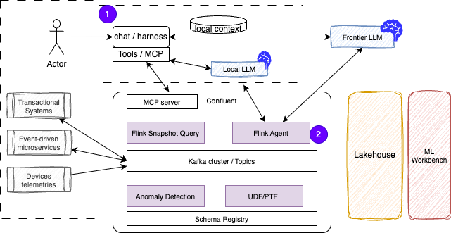
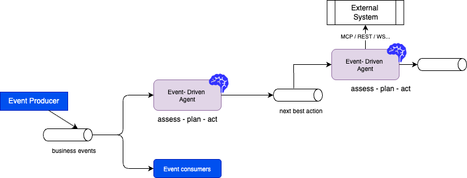
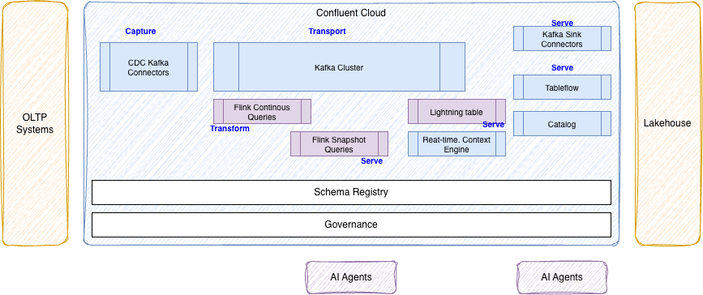
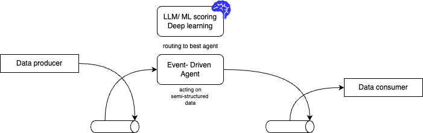
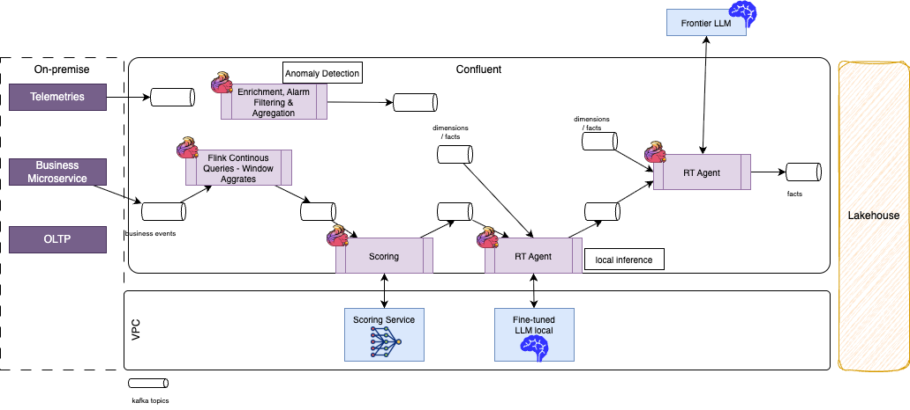
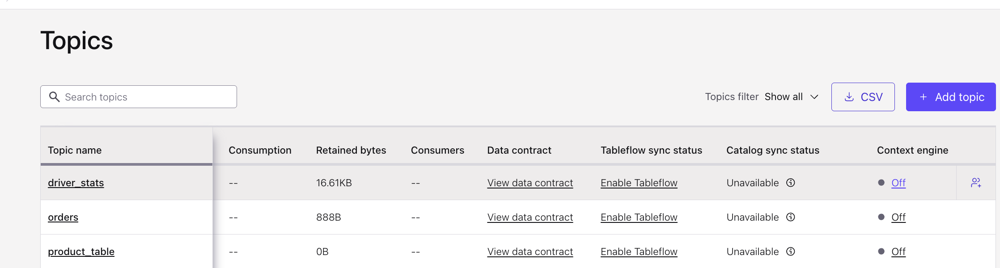
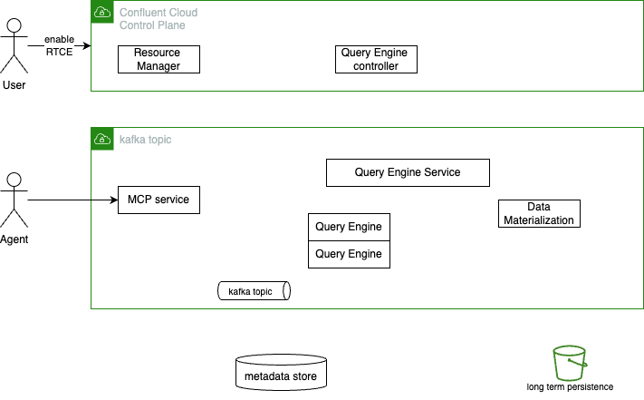
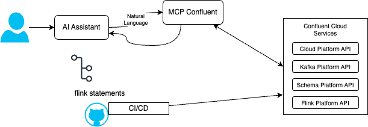

# Agentic Applications Cross Systems

???- "Version"
    Create 07/2025
    Update - 10/18/26

Industry analysts (as Gartner) project strong adoption of agentic AI in enterprise applications by 2028, with significant potential impact on automation and cost. Treat such figures as directional, not precise forecasts. One of the problems is that organizations do not have the right data for AI. Classical ML models are trained from historical data using batch processing; they are tailored for a specific use case with a specific feature set. Generative models are built on public human-generated unstructured information, and they generalize across many tasks. They do not know your organization’s data. Therefore a key challenge is to **deliver the right data at the right time with the right context.**

Traditional AI agents are reactive: you ask a question, they call an API, they give an answer. This works for chatbots, but it fails for autonomous systems. If you want an agent to monitor a factory floor or a global supply chain, it cannot wait for a human to type a prompt. It needs to "live" inside the data stream. Flink provides the stateful memory and time semantics that raw LLM calls alone do not give you.

* Request/Response: The agent is "asleep" until called.
* Flink/Event-Driven: The agent is "awake," maintaining a continuous state of the world as events fly by.

<figure markdown='span'>

<caption>High level view of RT-Agent components</caption>
</figure>

1. First high level use case will be a user leveraging harness with tools, MCP, local or frontier LLMs
1. The agent acts on events, uses LLM to extract information and decisions, and publishes results to kafka with exactly-once semantic.

## Who this chapter is for

* **Solution and enterprise architects** positioning GenAI, deep learning agent, on top of data platforms and event streams.
* **Streaming and platform engineers** integrating Kafka, Flink, and operational data.
* **ML and GenAI practitioners** who need to adopt autonomous agents acting on streaming events.

## Current Industry Challenges

* **Real-time context:** Answering "How do systems access relevant context in real time?" is still hard in practice.
* **Integration patterns:** Exposing data through every possible protocol has a cost. [Model Context Protocol (MCP)](https://www.anthropic.com/news/model-context-protocol) can centralize governed, discoverable tools and context for assistants, but it adds moving parts: tokens, routing, and security reviews. Many teams also wrap HTTP APIs, CLIs, or internal SDKs directly using tool declaration, for lower latency and simpler hardening. The two approaches coexist: use MCP where a shared context plane and tool contracts help integrations; prefer direct APIs when you need tight SLAs, air-gapped runs, or minimal indirection.
* While the medallion architecture and ELT batch jobs prepare data well, high end-to-end latency blocks agents that must act on fresh facts. You cannot have agents depend on data that is a day or a few hours old for many operational cases. Stale data served in production is a real issue. Data has a shelf life. The exact cutoff depends on the domain: sub-second to low-second processing matters for payment and safety-style signals; tens of seconds to minutes may be enough for other workflows. The point is order-of-magnitude fit, not a single universal latency number. A delayed batch-based alert can be far less useful than a stream-based one for the same business event.
* Many agentic frameworks are strong for demos and less opinionated about production: governance, guardrails, hardening, and observability still need your platform choices.
* Not all data must be real time; "real-time" is relative to the decision. The goal is still to feed domain-specific context from internal systems into generation and planning.
* Data often reaches AI systems too slowly. Businesses store data in many systems and silos, which makes a unified fresh view expensive.
* Several agent SDKs are not event-native: they may lack first-class replay, idempotent effects, and operations patterns teams expect from stream platforms.
* Live operational signals are not always represented in a single place for agents to consume.
* There is still a gap between data processing (Flink, Spark, ETL) and inference (APIs, vector DB, tools) that architecture must close.
* Frameworks that are disconnected from your data path struggle with governance, auditability, and replay at enterprise bar.

### MCP and direct tools (when to use which)

| Concern | MCP-oriented approach | Direct API / CLI / SDK |
| --- | --- | --- |
| **Discovery and contracts** | One protocol for tools and context; easier for many assistants | Per-service integration, more code |
| **Security model** | Mediated servers; org policies on what tools exist | You control per call; fewer hops |
| **Latency** | Extra hop; varies by deployment | Often lower, simpler paths |
| **Fit** | Shared context for many agents and IDEs | Tight-coupling to one app or pipeline |

Products such as [Confluent Intelligence](https://www.confluent.io/product/confluent-intelligence/) may expose governed, materialized context over MCP to AI apps while the stream platform (Kafka, Flink) stays the source of truth. That is MCP as an access pattern, not a claim that all agents must use MCP for everything.

## Context

AI agentic applications at scale will be triggered not only by users, but by systems using asynchronous events. Agents are expected to act as experts on tasks inside a business workflow, using domain knowledge, and to respond to user queries or to events from other systems.

As humans collaborate in a business function, AI agents will collaborate with other agents, other systems, and humans.

The vision is a fleet of streaming agents, background "teammates" that monitor data to:

* Optimize costs and drive revenue.
* Prevent outages and failures.
* Operate with varying levels of autonomy (including human-in-the-loop).
* Process right data at the right time with the right context.

Autonomous agents need a planning phase that uses up-to-date facts. Stale batch features pushed into an LLM invite hallucination and wrong actions. After assessment and planning, agents may act on external systems and emit events for downstream consumers.

<figure markdown='span'>
{: style="width: 1000px;" }
<figcaption>Event-driven context: business systems emit signals; stream processing materializes state and timing; agents consume compact, fresh context instead of ad hoc pulls.</figcaption>
</figure>

Agents may predict maintenance, tune parameters to reduce downtime, or balance supply in energy use cases. In healthcare (subject to policy and compliance), similar patterns apply to signals that combine history and live measurements, always with appropriate governance.

Flink’s event processing, state, and exactly-once semantics (where you configure it) support event-triggered agents. That is the layer where developers build much of real-time context.

Agents should not be limited to one database; they should participate in an ecosystem that consumes events, applies logic, and republishes results. That is the shift toward event-driven agents.

The [Streamhouse](./streamhouse.md) architecture presents integration with transactional systems, and lakehouse, with real-time context exposed as events and AI context. 



### Business use cases

Flink is especially useful when agents must reason over continuous, stateful, real-time events rather than isolated requests.

| Use case | What the agent does | Flink’s role |
| --- | --- | --- |
| **Real-time fraud investigation** | Detects suspicious transactions, gathers account/device context, scores risk, and recommends or triggers actions. | Stateful event correlation, sliding windows, enrichment, and exactly-once processing. | 
| **Autonomous IT/SRE operations** | Watches logs, metrics, traces, and deployment events; identifies incidents; investigates likely causes; and executes approved remediation. | Joins operational streams, maintains incident state, detects patterns, and tracks recovery. | 
| **Personalized recommendations** | Continuously adapts recommendations based on clicks, purchases, searches, and session behavior. | Per-user state, real-time feature computation, and low-latency model inference. | 
| **Customer-support agents** | Detects customer frustration or escalation risk from conversations and account events, then recommends next-best actions. Every customer interaction is streamed as an event the instant it occurs. | Combines chat, CRM, product-usage, and billing streams in real time. Streaming Agents run live transcription and analysis in-flight. | 
| **Predictive maintenance** | Monitors sensor data, detects abnormal behavior, diagnoses probable failures, and schedules maintenance. | Time-series processing, anomaly detection, event-time windows, and device state. |
| **Real-time inventory** | Cameras recording shelves. Tens of millions of shelf scans per day. Move to 95% shelf availability accuracy. No batch processing. | Flink processing and routing it into the Shelf AI product in real time | 
| **Dynamic pricing and promotions** | Adjusts offers based on demand, inventory, customer behavior, and competitor signals. | Real-time aggregation, rule evaluation, and continuous feature updates. | 
| **Supply-chain exception handling** | Detects shipment delays or inventory risks, identifies downstream impact, and proposes alternate suppliers or routes. | Correlates orders, inventory, logistics, and external event streams. | 
| **Compliance monitoring** | Reviews financial or operational events, detects policy violations, and creates investigation cases with supporting evidence. | Stateful pattern detection, temporal rules, and immutable event processing. | 
| **Autonomous data-quality remediation** | Detects schema changes, late data, duplicates, or anomalous values; determines likely causes; and opens or resolves tickets. | Stream validation, anomaly detection, lineage context, and stateful monitoring. | 
| **Real-time knowledge agents** | Maintains a current view of entities such as customers, products, or accounts so an agent can answer using the latest facts. | Builds continuously updated materialized views and retrieval-ready state.|
| **Financial transactions** | Detecting changes in trading volume and alerting a person; learning trends on individual names. | Stateful pattern detection, Real-time aggregation |
| **Healthcare device monitoring - care plan** | Analyze spikes or dips in medical devices according to prescriptions. | Stream validation, anomaly detection, correlation. |
|  **Product reviews** | Classify sentiment, then use anomaly detection on negative share to catch incidents early. | Anomaly detection, Real-time aggregation |

## Requirements

### Cost, throughput, and models

* **Cost model:** Pushing every business event through an LLM is often prohibitively expensive. Use traditional ML (anomaly detection, fraud detection, forecasting) or business rules as a first-pass filter, and reserve LLM steps for text based tasks.
* **Inference and enrichment:** As already said, fresh data from transactions into context for agents brings more value than stale data. Stale data drives weak recommendations. Private data is often integrated at inference and through RAG rather than by training.

### Data preparation and search

* **Offline training and features:** Many models still need batch preparation, clean data and feature pipelines. That data is often at rest before it trains predictive models.
* **Search and graph:** Full text, vector, and graph retrieval enrich LLM context. Point-in-time and temporal joins matter so retrieval matches event time, not "whatever was latest in the index."
* **RAG in motion:** RAG should be updated as sources change. Using static snapshots fall behind and bring poor data quality.
* **Remote scoring:** Stream processing may call remote model endpoints. Implementation needs to protect with backpressure, timeouts, retries and budgets.

### Platform and operations

* **Prefer event-driven integration**: messaging and stream contracts instead of only static orchestrators (for example Apache Airflow) for all operational reactions, use batch orchestration where it fits, streams where time is of the essence.
* Event processing can trigger agents: External tools can be reached via MCP, cli or direct APIs, depending on the pattern above.
* Embedded and edge cases (for example drones) add safety and bandwidth constraints beyond the data center.

???- info "Decision Intelligent Platforms"
    Gartner defines decision intelligence platforms (DIPs) as software to create decision-centric solutions that support, augment and automate decision making of humans or machines, powered by the composition of data, analytics, knowledge and AI.


## Understanding real-time data needs

You can assess needs from a business and an architecture angle.

### Project discovery questions

* What are the current GenAI goals and projects?
* What is the size and practice of the ML/AI team?
* How is data delivered as context to agents today?
* What is the measured latency from transactional data to the agent as context?
* How do you ensure trust in AI output?
* How do you operate agents in production (SLOs, on-call, cost)?
* How are actions taken once the agent proposes a "next best action?"
* What guardrails prevent dangerous side effects?

### Architecture questions

Kafka and Flink help only after you state what "real time" means for each feature: detection, ranking, or human escalation.

* What analytics and features do user journeys need for engineering and inference?
* Which tasks should be event-driven and closed-loop (for example anomaly response)?
* What "next best action" must happen within which latency budget?
* Do you need exactly-once, at-least-once, or idempotent sinks?
* Which processes need sub-minute or sub-second data, and which can stay batch?
* What batch jobs would improve if they consumed curated stream outputs?
* For each agent, does the decision require a continuous stream, windows, or only occasional API calls?


## Event-driven AI agent

Lilian Weng’s agent survey [via this summary](https://jbcodeforce.github.io/ML-studies/genAI/agentic/#introduction) is a common reference for planner, memory, and tools, it helps you reason about your agent design. Microservices teams already use event-driven integration; the same choreography idea extends to agents that emit and consume stream events. The high-level view below is Kafka-centric: logs give you ordering, replay, and decoupling.

<figure markdown='span'>
{: style="width: 1000px;" }
<figcaption>EDA for agents: services publish facts; stream processors derive features and triggers; agent runtimes and tools sit behind clear contracts, often with multiple consumer groups and replays for test.</figcaption>
</figure>

The event-driven agent may be implemented using Apache Flink for stateful aggregation, data transformation and filtering to prepare a relevant and fresh context to the LLM. The agent remote calls the inference endpoint and produces results in another table.  

With Kafka, you can replay a time range to reproduce why a probabilistic model behaved a certain way, usually easier than re-building a one-off batch extract for the same question.

LLMs are not the only implementation: classic ML scoring, calibrated rules, and deep-learning models all have a place, depending on data quality, cost and risk.

### Reference data-flow pattern

The following pattern appears throughout this book: ingest events, derives time-bounded state, optionally scores with cheap models, then optionally calls expensive frontier LLMs, then emits downstream facts (also durable on Kafka) for other agents and systems.

<figure markdown='span'>

<caption>Real-time processing and AI based flow</caption>
</figure>

## Technologies

### Apache Flink Agents

[Apache Flink Agents](https://nightlies.apache.org/flink/flink-agents-docs-latest/docs/get-started/overview/) is an open-source framework for event-driven streaming agents. Multiple patterns are in scope:

1. **Workflow streaming agents:** a directed workflow of actions connected by events, a form of [SAGA  choreography](https://jbcodeforce.github.io/eda-studies/patterns/saga/#services-choreography). See the [Apache Flink Agents repository](https://github.com/apache/flink-agents) and the Python [workflow example](https://github.com/apache/flink-agents/blob/main/python/flink_agents/examples/quickstart/workflow_single_agent_example.py).
    * The [`flink_agents.api.agents.agent.Agent` class](https://nightlies.apache.org/flink/flink-agents-docs-main/docs/development/create-agent/overview/) defines the contract each agent implementation, deployed into a task manager, will have to conform to. One function to process the event as input, and a second methods to post process the LLM response.
    * The SDK wraps each input record in an InputEvent. `ChatRequestEvent` and `ChatResponseEvent` are classes to manage interactions with  LLM
    * Annotations are used for defining prompt, tools, model description, skills (bundled in the deployed package) `flink_agents.api.skills.Skills`,
    * A runner context, `flink_agents.api.runner_context.RunnerContext`, provides Flink engine access to remote service to send request as event.

2. **ReAct pattern:** the user states a goal; the agent interleaves reasoning and tools use with an LLM. The Python [ReAct example](https://github.com/apache/flink-agents/blob/main/python/flink_agents/examples/quickstart/react_agent_example.py) shows the idea. A runnable port with OSS Flink and Kafka lives under [e2e-demos/agentic-demo](https://github.com/jbcodeforce/flink-studies/tree/master/e2e-demos/agentic-demo) in this repository.

### Confluent Intelligence

Confluent’s stream processing and governance offerings help you build event-driven pipelines for continuous AI context: capture data as it is generated, curate it in Flink SQL, and serve it to AI systems. The product direction is a unified, real-time, trust-oriented view of the business. See [Confluent Intelligence documentation](https://www.confluent.io/product/confluent-intelligence/). Current generative AI uses data to continuously learning and adapting the logic and response. This should not be considered without risk, and static business logic and rules should never be undeterministic. Rule based systems have still their important play in modern AI, ignoring it, will lead company in mined land.

[Confluent Cloud for Apache Flink](https://docs.confluent.io/cloud/current/ai/overview.html) combines, at a high level:

1. **Built-in ML in SQL:** [model-oriented functions](https://docs.confluent.io/cloud/current/flink/reference/functions/model-inference-functions.html) for anomaly detection, forecasting, and similar use cases, with downstream routing to topics or agents.
2. **Streaming agents:** [Streaming Agents](https://docs.confluent.io/cloud/current/ai/streaming-agents/overview.html) run as Flink-backed, stateful units with timers and replay-friendly testing story (see Confluent docs for current limits and regions).
3. **Real-time Context Engine:** can expose governed, materialized data to other apps, in some flows via MCP, so not every team must hand-wire Kafka details. It is enabled at a topic level. 
  

  Once enabled, 3 tools are available: `getMetadata`, `listTopics`, `queryData` to a code agent like Claude, Cursor, IBM Bob or your own.

#### Capabilities

* **Real-time processing:** Kafka paired with Flink, with [ML](https://docs.confluent.io/cloud/current/flink/reference/functions/model-inference-functions.html) and [preprocessing](https://docs.confluent.io/cloud/current/flink/reference/functions/ml-preprocessing-functions.html) helpers in SQL, including [anomaly detection](https://docs.confluent.io/cloud/current/ai/builtin-functions/detect-anomalies.html) using ARIMA-style and MAD algorithms.

* [Anomaly detection predefined function for Flink processing](https://docs.confluent.io/cloud/current/ai/builtin-functions/detect-anomalies.html):

    * Detect anomalies in your data using a forecasting model based on Autoregressive Integrated Moving Average (ARIMA). - ML_DETECT_ANOMALIES
    * Detect univariate and multivariate anomalies in your data by using Median Absolute Deviation (MAD) - ML_DETECT_ANOMALIES_ROBUST 
    * Detect anomalies in time-series data using model-based inference with foundation models like TimesFM - AI_DETECT_ANOMALIES uses models that are managed by Confluent and hosted in Confluent Cloud.
* **Interoperability:** MCP for context to diverse clients; your stream platform remains the system of record for *what happened*.
* **Governance and replayability:** Security, lineage, and using the log to re-run and debug model behavior.
* [Confluent AI with Flink SQL](https://docs.confluent.io/cloud/current/ai/overview.html) to decouple producers, processors, and consumers, including agents.

Other agent protocols (for product integration) include [Google A2A](https://developers.googleblog.com/en/a2a-a-new-era-of-agent-interoperability/) and the [Agent Communication Protocol](https://agentcommunicationprotocol.dev/introduction/welcome) from the Linux Foundation ecosystem, alongside [Anthropic’s MCP](https://www.anthropic.com/news/model-context-protocol) for tools and context to models. Native inference on Confluent Cloud (where available) and multivariate anomaly detection are product-specific; check current documentation for your environment.

The [quickstart-streaming-agents](https://github.com/confluentinc/quickstart-streaming-agents/) includes examples such as price monitoring, RAG over vector-backed text, and taxi demand with anomaly handling.

#### Quick demonstration (Confluent Cloud)

`CREATE MODEL`, `CREATE TOOL`, and `CREATE AGENT` are Confluent Cloud Flink SQL features to define streaming agents. They are not part of plain open-source Apache Flink. You need a Confluent Cloud environment, and the right accesses.

Typical order of operations in the Console or SQL workspace:

2. **CREATE MODEL** – register a remote or platform model reference (for example OpenAI or a governed endpoint). Follow the [model](https://docs.confluent.io/cloud/current/ai/streaming-agents/) documentation for your provider.
3. **CREATE TOOL** – map Flink UDFs, procedures, or MCP-connected tool definitions the agent may call.
4. **CREATE AGENT** – bind model, tools, and a system prompt, with limits in the `WITH` clause.

Example shape (placeholders; align names with your catalog):

```sql
CREATE AGENT support_triage_agent
  USING MODEL my_registered_model
  USING TOOLS my_tickets_query_tool
  USING PROMPT 'You help route support events. Be concise. Escalate only on clear policy breaches.'
  WITH (
    'max_iterations' = '5',
    'max_consecutive_failures' = '3',
    'request_timeout' = '60'
  );
```

The [code/flink-sql/12-ai-agents](https://github.com/jbcodeforce/flink-studies/tree/master/code/flink-sql/12-ai-agents) includes an example of anomaly gating. 

The local, based Apache Flink Agents demo is under [e2e-demos/agentic-demo](https://github.com/jbcodeforce/flink-studies/tree/master/e2e-demos/agentic-demo).

### Real-Time Context Engine

[Real-Time Context Engine (RTCE)](https://docs.confluent.io/cloud/current/ai/real-time-context-engine/overview.html) is a set of features to serve structured context to any AI apps or agents via MCP for real time data. RTCE integrates with AI harnesses via MCP protocol. This is not the same as Confluent MCP Server, used to manage resources in Confluent Cloud.

* Enabled at the topic level, fully managed serverless backend, multi-tenants. It is a regional service but can query resources at the global or regional level. Enabled via Console, Terraform, CLI or REST API. IT is important to tune the description so Agent can select the topic from user's queries
* It materializes the topic data into a table in a low-latency data-serving layer optimized for fast lookups.
* Query engine prepares query plan
* RBAC for topic access, API key with Global resources.
* Pay only for the compute and storage used
* Support append log, or upsert mode where RTCE keeps only the latest record for each key. The selection is based on the topic’s `cleanup.policy`
* AI Agent can access RTCE data plane via CC API Key and Secret. RTCE authenticates MCP requests with HTTP Basic authentication using a base64 of key andd secret

The high level architecture for RTCE and the EA Lighting Tables looks like:



* The [`queryData` tool](https://docs.confluent.io/cloud/current/ai/real-time-context-engine/query-data.html#querydata) goes to a SQL query engine controller and are continuously executed by query engine process(pod). A set of metadata services keep access control and where to find data. Data may be persisted of local storage or fast object storage. Those queries are select and filter with limit to do not returns millions of record. The where by id will be the most common query created by the AI harness and agent. Stateful queries are not possible, but those queries can get data from a topic that is itself an output of Flink processing.
* Warm / hot data come from Kafka topic, cold data may come from materialized iceberg tables.

* See a terraform to enable [RTCE on c360 profile](https://github.com/jbcodeforce/streamhouse_c360_demo/blob/main/IaC/rtce/rtce.tf), and the [demonstration dashboard](https://github.com/jbcodeforce/streamhouse_c360_demo/blob/main/docs/demo_script.md) which integrates with Confluent REST API for lightning query or RTCE MCP server.

### Confluent Cloud - MCP Server

The [mcp-confluent](https://github.com/confluentinc/mcp-confluent) project exposes Confluent Cloud APIs to assistants (topics, Flink statements, Connectors, Schema Registry, and more). The diagram below is a human in the loop story: natural language in an IDE suggests Flink SQL or config, review in Git, deploy through CI/CD—not unaudited production changes from chat alone.

<figure markdown='span'>
{: style="width: 1000px;" }
<caption>MCP to Confluent: assistants propose changes; version control and pipelines keep governance and rollbacks; Kafka and Flink stay managed by the platform team.</caption>
</figure>

The MCP client needs [to define two servers](https://docs.confluent.io/cloud/current/ai/ai-tools/managed-mcp-server.html#configure-claude-code): the global and regional.
The server exposes many tools; categories include Kafka, Flink SQL, Schema Registry, Kafka Connect, Tableflow, and platform management (environments, clusters). See the repository for the current list.

| Service Category | Examples |
| ---- | ---- |
| Kafka Operations | list-topics, create-topics, produce-message, consume-messages, alter-topic-config, … |
| Flink SQL | list-flink-statements, create-flink-statement, read-flink-statement, … |
| Schema Registry | list-schemas, search-topics-by-tag, … |
| Kafka Connect | list-connectors, create-connector, … |
| Tableflow | create-tableflow-topic, list-tableflow-topics, … |
| Platform | list-environments, read-environment, list-clusters |

### Example of natural language queries

* Inventory

    ```sh
    what are the topics in my kafka cluster?
    ```

* Flink SQL assistance

    ```sh
    looking at the tx_items topic and schema definitions, I want a flink sql statement to deduplicate records from this CDC raw topic
    ```


## More information - Sources

* [code/flink-sql/12-ai-agents](https://github.com/jbcodeforce/flink-studies/tree/master/code/flink-sql/12-ai-agents): Anomaly detection and gating to a downstream view; links to replay notes.
* [AI Model Inference and Machine Learning Functions in Confluent Cloud for Apache Flink](https://docs.confluent.io/cloud/current/flink/reference/functions/model-inference-functions.html) (including `AI_TOOL_INVOKE` patterns where applicable).
* [Streaming Agents Examples with Confluent Cloud](https://docs.confluent.io/cloud/current/ai/streaming-agents/streaming-agents-examples.html)
* [Confluent quickstart streaming agents](https://github.com/confluentinc/quickstart-streaming-agents/): [LAB3 walkthrough](https://github.com/confluentinc/quickstart-streaming-agents/blob/master/LAB3-Walkthrough.md) (fleet-style scenario).
* [Demonstration for fraud detection agent.](https://github.com/confluentinc/demo-confluent-fraud-agent)
* [Apache Flink Agents documentation](https://nightlies.apache.org/flink/flink-agents-docs-latest/docs/get-started/overview/).
* [F1 Pit Wall AI: River Racing at Silverstone:](https://github.com/confluentinc/demo-confluent-intelligence-f1) A real-time AI pit-strategy system on Confluent Cloud. Live telemetry and race standings stream into Kafka, Flink SQL detects a front-left tire anomaly, and a Streaming Agent recommends whether River Racing should pit now, pit soon, or stay out, explaining its reasoning in natural language.
* [SQL CREATE AGENT (Confluent Cloud)](https://docs.confluent.io/cloud/current/flink/reference/statements/create-agent.html).
* [IBM Bob Workshop - Event-Driven AI Agents with Confluent Cloud](https://juseljuk.github.io/bobchestrate-workshop/advanced/part2-confluent)

