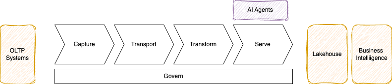
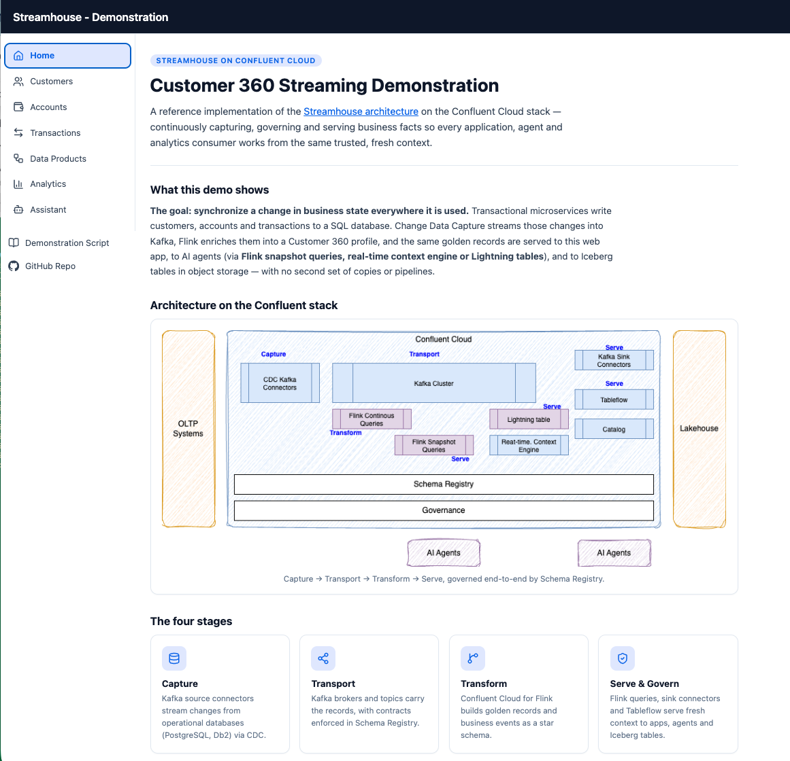
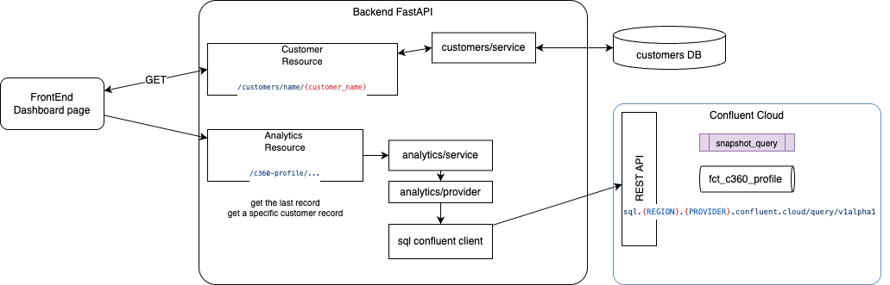
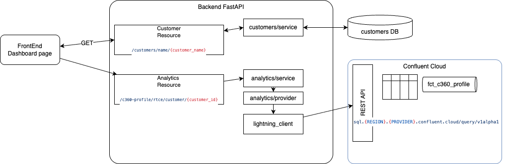
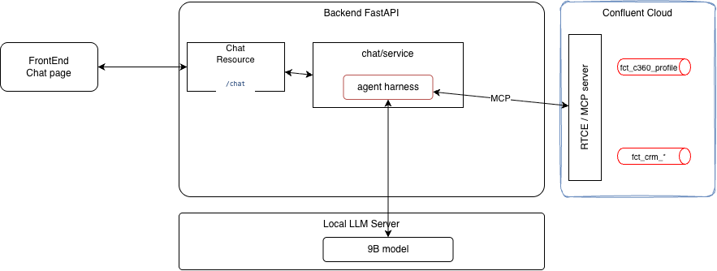
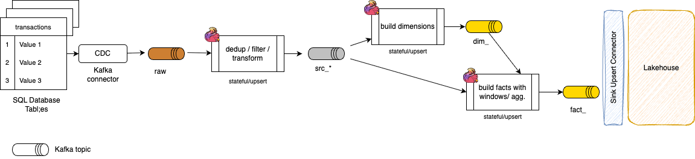

# Streamhouse

[Streamhouse](https://streamhouse.com/) is an open, vendor-neutral category for data architectures that keep the current state of a business continuously available to production applications, analytics, and AI agents. This is a key initiative, started by Ververica and embrassed by Confluent and IBM in 2026 with the need to serve fresh data to human and AI agents. It is a new category, but a description of an older pattern which uses of open standards like Kafka, Flink, and self built solution.

## High level View

It groups change data capture, event streams, stream processing, open table formats, catalogs, and low-latency serving. 

<figure markdown='span'>

<caption>High-level capabilities</caption>
</figure>

**Data remains continuously current as business events occur**. Streamhouse is in the operational critical path for data production to human and AI agents.

This is the architecture to support the end-to-end vision of data as a product, starting from the [methodology](../methodology/data_as_a_product.md/), and implementated with Kafka, Flink, Schema registry, Connectors...  

As streamhouse consumes data from operational and transactional systems and serve important business events to take business decisions, keeping it running represents challenges and risks. With added complexity of hybrid cloud deployments. When a distributed state store desynchronizes or upstream schemas mutate without warning, IT and SREs carry the full liability of production downtime.

## Concrete Confluent Based Architecture

The Confluent distribution of a streamhouse is the Data streaming platform (DSP). The DSP is a  complete, cloud-native foundation. It is built on open standards such as Apache Kafka, Apache Flink and Apache Iceberg and offers proprietary, differentiated features designed to abstract complexity of building and operating a streamhouse.

<figure markdown='span'>

<caption>High-level View of Confluent Cloud Streamhouse</caption>
</figure>


* **Capture:** Data ingestion is supported by Kafka source connectors
* **Transport:** Raw records, meaning business events, entity states,... are in Kafka topics distributed and highly-available in broker cluster.
* **Govern**: Schemas enforce contract for consumers to understand data, with strategy to facilitate schema evolution 
* **Transform**: Flink SQL statements, TableAPI jobs helps to prepare star schema elements for direct consumption for running application, or to land into Lakehouse systems
* **Serve** to running applications: 
    * [**A snapshot query**](https://docs.confluent.io/cloud/current/flink/concepts/snapshot-queries.html) is a one-time Flink SQL query that reads a consistent, point-in-time view of a table, returns the results, and then terminates.
    * [**Lightning Table**](https://docs.confluent.io/cloud/current/lightning-tables/overview.html): supports low-latency SQL queries on primary key of Flink table.
    * [**Tableflow**](): To write parquet files as Apache Iceberg tables or Delta tables. Catalog of those tables are available for governance and federation.
* 

Tableflow, snapshot queries, stream governance, schema registry, and lightning tables are expressly designed to support Streamhouse adoption.

Streamhouse does not have to be only SaaS, and some elements may run in VPC and private data center. Confluent Platform offers also Streamhouse components to support hybrid solution.

### Demonstrations

As part of an internal project, I have to develop [this streamhouse demonstration](https://github.com/jbcodeforce/streamhouse_c360_demo/) on top of Confluent Cloud, with infrastructure as code, Flink processing deployed with dbt, and using materialized tables, schema registry, CDC connector, and an application to demonstrate the art of possible for complex snapshot query, or lightning table query as well as AI agent querying with MCP tools.



### Some patterns

???+ info "Integrating with snapshot query"
    This is mostly supported by layer like [Confluent sql module](https://pypi.org/project/confluent-sql/) and can be integrated in any application code like (not production [See also confluent_sql_client.py](https://github.com/jbcodeforce/streamhouse_c360_demo/blob/main/apps/backend/analytics/confluent_sql_client.py)) from streamhouse demo:
    ```python
    def query(self, sql: str) -> list[dict]:
    # try and catch removed
        conn = confluent_sql.connect(
                organization_id=s.FLINK_ORG_ID,
                environment_id=s.FLINK_ENV_ID,
                cloud_provider=s.CLOUD_PROVIDER,
                cloud_region=s.CLOUD_REGION,
                compute_pool_id=s.FLINK_COMPUTE_POOL_ID,
                flink_api_key=s.FLINK_API_KEY,
                flink_api_secret=s.FLINK_API_SECRET,
                database=s.FLINK_DATABASE,
                database_kafka_cluster_id=s.KAFKA_CLUSTER_ID,
            )
        cur = conn.cursor()  # snapshot mode is the default
        cur.execute(sql)
        columns = [d[0] for d in (cur.description or [])]
        return [dict(zip(columns, row)) for row in cur.fetchall()]
    ```

    See an integration pattern:
    


???+ info "Querying Lightning Table"
    This is REST API client code to POST the query. [See more complex integration](https://github.com/jbcodeforce/streamhouse_c360_demo/blob/main/apps/backend/analytics/lightning_client.py) as below is just simple flow: 
    ```python
    def query(self, sql: str, fallback_columns: Sequence[str], max_rows: int) -> list[dict]:
        body = {
            "catalog_name": s.FLINK_ENV_ID,
            "database_name": s.KAFKA_CLUSTER_ID,
            "query": sql,
            "options": {"max_result_rows": max_rows, "result_format": "JSON"},
            "client_info": {},
        }
        context = (
            f"catalog={s.FLINK_ENV_ID} database={s.KAFKA_CLUSTER_ID} "
            f"key={_key_prefix(s.CONFLUENT_GLOBAL_KEY)}"
        )

        response = httpx.post(
            self._endpoint(),
            json=body,
            auth=(s.CONFLUENT_GLOBAL_KEY, s.CONFLUENT_GLOBAL_SECRET),
            timeout=_REQUEST_TIMEOUT_SECONDS,
        )
        response.raise_for_status()
        payload = response.json()
    ```


    See an integration pattern:
    

???+ info "Integrating a local agent to a local LLM"
    This time the approach is to have local agent that access tools and MCP server, to query business data exposed by Confluent Real-time context engine. [See complete code using Agno SDK](https://github.com/jbcodeforce/streamhouse_c360_demo/blob/main/apps/backend/chat/agent.py)

    ```python
    async def run_agent( message: str, history: list[ChatMessage], session_id: str | None = None) -> str:
        # simplified code
        if session_id:
            entry = await _get_or_create(session_id)
            async with entry.lock:
                result = await entry.agent.arun(input=prompt, session_id=session_id)
            return (result.content or "").strip()
        return await _run_stateless(prompt)
    ``` 

    The architecture looks like:
    

    And an example of response retrieved from Kafka / Table and exposed via LLM translation:
    

## Shifting to real-time processing

Preparing medallion layers is possible by using data already in Kafka. The classical batch processing can be shifted to the left of the architecture, by doing transformation, filtering, deduplication to build the silver layer in Kafka Topic using Flink processing. 

<figure markdown='span'>

</figure>

The business logic that applies to data in Kafka topics so in Flink tables can be built in Flink to create gold records. Those gold records, representing dimensions and facts, can be persisted for long term in object storages, in Iceberg Tables. An external query engines, and federated catalog can be used on top of those Iceberg Tables.  Most of the logic done in batch should be easily ported to real-time processing. Still some consideration like state size, running all time streaming processing, time and watermark add to the semantic complexity.

Adopting an event-driven architecture, silver and gold topics/ business events are reusable and not just usable for analytic query engines.


## 