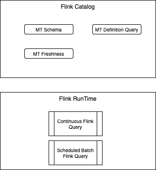
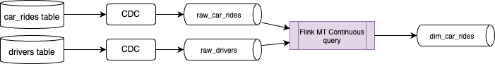
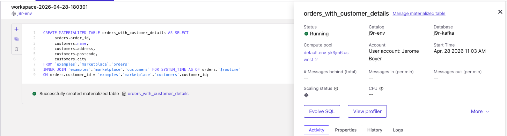
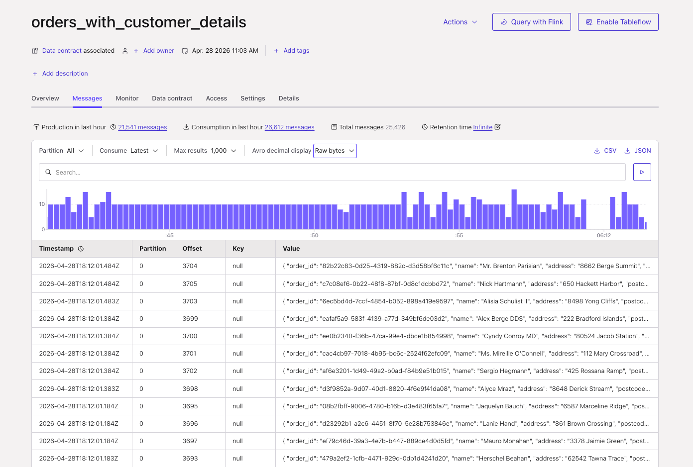
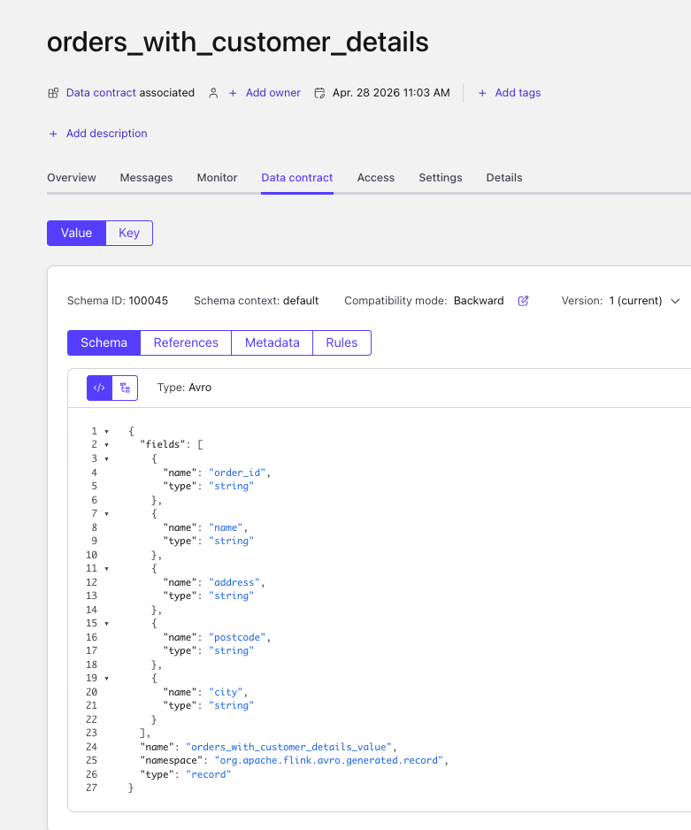
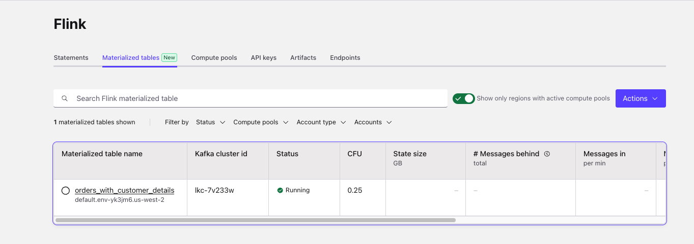
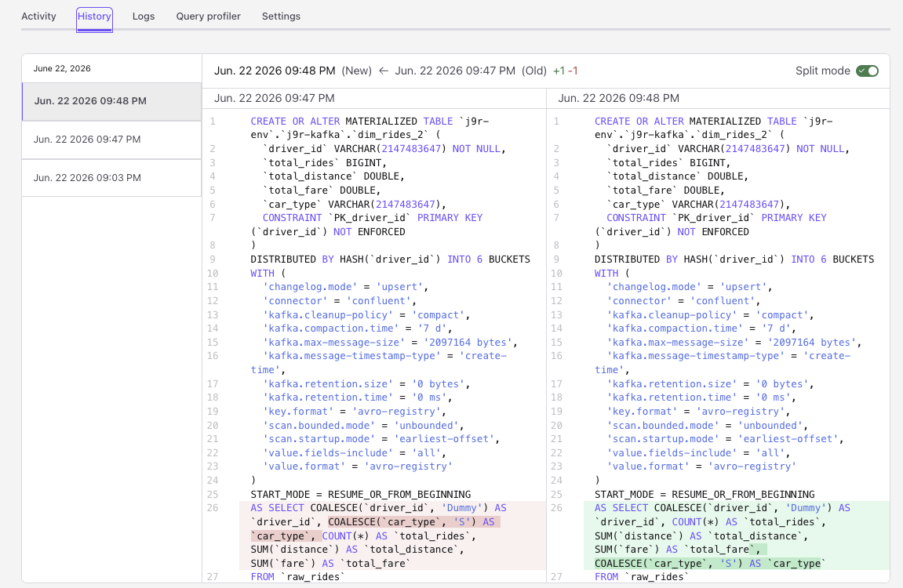

# Materialized Tables

## Current Challenges

With Flink SQL statements, developers who need to update the pipeline's logic (e.g., changing a query), have to perform a manual, error-prone process: they must stop the existing statement, create a new table with the updated query, manually manage stream offsets to prevent data loss, and migrate the downstream consumers to the new topic. This process is largely incompatible with modern CI/CD and GitOps practices.

## Concepts

[Materialized Tables](https://nightlies.apache.org/flink/flink-docs-stable/docs/dev/table/materialized-table/overview/)(MT) helps to manage tables in long term with easier development life cycle than traditional Flink Tables. They are the recommended solution for creating permanent, evolving streaming pipelines.

Materialized Tables includes the following elements:

<figure markdown='span'>
{ width=400 }
</figure>

* **Schema Definition:** derived or user defined, the same way as other Flink Table.
* **Query definition:** the business logic to process the input data to output table.
* **Refresh mode:** FULL(scheduled Flink batch job) or CONTINUOUS (run a Flink job to update the content of the table). This setting is inferred from the data freshness configuration
* **Data freshness:** the maximum amount of time that the MT content should lag behind updates to the base tables. Defaulted to 3 minutes for CONTINUOUS mode (= checkpoint frequency) & 1h for FULL mode (batch schedule).
* **start mode:** to control the reprocessing: resume from the previous job's position, process only new data, reprocess from the beginning, from a specific timestamp, or from a relative interval like FROM_NOW('7' DAY)

The query results are updated to the materialized table continuously, while in FULL mode, the query results overwrite the materialized table each time.

Materialized Tables support in-place evolution via the `CREATE OR ALTER MATERIALIZED TABLE`command. This feature automates complex administrative tasks such as offset management and schema synchronization. Whenever a new MT definition is submitted, the control plane stops the `system statement`, performs the necessary evolutions and starts a new system statement. Flink system statements are only visible via REST API and Metrics API.
*Unlike a regular CREATE TABLE combined with an INSERT INTO statement, a materialized table is a single declarative object that owns both the table definition and the continuous query.*

* With full mode, there is a scheduler that triggers a batch job to refresh the materialized table data. 
* With CONTINUOUS, data freshness is converted into the checkpoint interval of the Flink streaming job.
* Materialized Tables are defined as other Flink tables, with the MATERIALIZED keywords. [See the syntax](https://nightlies.apache.org/flink/flink-docs-release-2.2/docs/dev/table/materialized-table/statements/), and uses a CTAS structure
    ```sql
    CREATE MATERIALIZED OR ALTER TABLE orders_table
    FRESHNESS = INTERVAL '10' SECOND
    START_MODE = RESUME_OR_FROM_BEGINNING
    REFRESH_MODE = CONTINUOUS
    AS SELECT * FROM kafka_catalog.db1.orders;
    ```
* Materialized tables use the same table properties and defaults as CREATE TABLE — including `changelog.mode` — and support the exact same WITH options.
* Use CREATE OR ALTER MATERIALIZED TABLE, to suspend and resume, refresh pipeline of materialized tables, to manually trigger data refreshes, and to modify the query definition of materialized tables. Users can control how much historical data is processed during these updates by configuring the START_MODE parameter. In Confluent Cloud the START_MODE default value is RESUME_OR_FROM_BEGINNING.

* In Apache Flink, SUSPEND needs to set the savepoint directory:
    ```sql
    SET 'execution.checkpointing.savepoint-dir' = 'file:///Users/jerome/Documents/Code/flink-studies/code/flink-sql/13-materialized-table/savepoints';

    ALTER MATERIALIZED TABLE continuous_users_shops SUSPEND;
    ```

* It is possible to trigger a refresh:
    ```sql
    CREATE OR ALTER MATERIALIZED TABLE my_materialized_table REFRESH;
    ```
* `ALTER... AS` will change the table schema, and then refresh the data. Changing the schema means, adding new column with default value. Changing the type of a column, leads to dropt the MT and recreate it. In FULL mode, not partitioned, the table will be overwritten. With partioning it will refresh the latest partition. With CONTINUOUS, the new refresh job starts from the beginning and does not restore from the previous state.
* When runing, ALTER MATERIALIZED TABLE that changes a GROUP BY or window definition in a stateful aggregation, the old aggregation state is discarded. The new results are rebuilt from scratch. Users often expect continuity and are surprised by the reprocessing cost. Use START_MODE = FROM_NOW if the statement do not need historical recomputation. 
* for stateless in-place migration, there will be some impact according to the changelog.mode set: upsert produces zombie keys, retract emits inserts without deletes, append-only produces duplicates.
* Use SHOW CREATE MATERIALIZED TABLE <name> to get the changelog mode (upsert, retract, append-only), the current query, and the WITH properties. Zombie / duplicate triage depends on knowing the changelog mode first. This command also shows FRESHNESS and REFRESH_MODE values.
* In Confluent Cloud, it is possible to convert an existing topic/table to a materialized table. In those table was created and updated by an existing Flink statement, this one needs to be stopped.
* Service Account or User needs `FlinkDeveloper` to compute pool, `ResourceOwner` on kafka cluster, `DeveloperRead` on topics.

### dbt support

Confluent dbt supports [creating materialized table](), with the `config()` macro that defines the MT parameters.

```sql
{{ config(
    materialized = 'materialized_table',
    start_mode='FROM_BEGINNING', 
    distributed_by={'columns': ['account_id'], 'buckets': 1},
    with= {
        'changelog.mode': 'upsert',
        'kafka.cleanup-policy': 'compact',
        'scan.bounded.mode': 'unbounded',
        'scan.startup.mode': 'earliest-offset',
        'key.format': 'avro-registry',
        'value.format': 'avro-registry',
        'value.fields-include': 'all'
    })
 }}


SELECT
  a.account_id, 
  a.customer_id, 
  a.account_type, 
  a.status AS account_status, 
  a.balance,
  COALESCE(t.txn_count, 0) AS txn_count,
  COALESCE(t.txn_total, 0) AS txn_total,
  t.last_transacted_at
FROM {{ ref('src_accounts') }} a
LEFT JOIN (
  SELECT 
    account_id, 
    COUNT(*) AS txn_count, 
    SUM(amount) AS txn_total,
     MAX(transacted_at) AS last_transacted_at
  FROM {{ ref('dim_transactions') }}
  GROUP BY account_id
  ) t
ON a.account_id = t.account_id
WHERE a.account_type = 'CHECKING'
```

## Architecture

The SQL Gateway is the important component to manage the life cycle of MT. It includes a workflow scheduler to manage periodic refresh jobs.


For Confluent Cloud, MTs use exactly the same RBAC model as other Flink Statements, including the Flink roles and the requires Kafka and/or Schema Registry roles. If a user adds a projection to their query, Flink will take care of evolving the schema in Schema Registry (for the schema belonging to the sink table/topic) too. If there is a failure during an evolution, the MT will transition to Failed and not roll back to the previous state

## Limitations

* No Statement Sets: Materialized tables cannot be grouped or used within Flink statement sets
* **Not Idempotent**: Running a CREATE OR ALTER command on a materialized table will always trigger a new evolution and **discard state**, even if the query logic hasn't changed. State is rebuilt from the source. 
* User can’t define a Materialized Table on an existing Kafka topic, a new MT needs to be defined from data of this topic.
* **No Automatic Change Detection**: Neither materialized tables nor statements will automatically detect changes to upstream dependencies (like a source topic's schema changing); an evolution must be explicitly triggered by using CREATE OR ALTER TABLE.
* During reprocessing, append-sinks will **receive duplicates**.
* Confluent Cloud: All existing capabilities from Statements are also available for MTs (like Query Profiler, Billing, Metrics API). System Statements are only visible via the REST API and Metrics API, but users can not control them.

## CI/CD considerations

* CREATE OR ALTER MATERIALIZED TABLE in CI/CD without a change-detection gate will trigger a MT migration. It is strongly recommended to add control using a SHA or git-diff check, before running the CREATE OR ALTER dml. When idempotency will be supported this restriction may change.
* When deploying MTs in the same compute pool, as all MT are mutables, any Flink developers can change those tables. It may be better to use one compute pool per MT to enforce better isolation boundary. 

## Monitoring

Confluent Cloud / Flink / Meterialized Tables offers a way for the users to select a table and see metrics. Materialized table metrics are also accessible via the REST API. 

Flink statement and materialized table metrics contribute to the Compute pool metrics. Materialized table metrics do not appear as statement-level metrics.
Materialized table metrics will not appear as statement-level metrics: the metric `num_records_in` at the compute pool level represents the total throughput. When aggregated by statement name, it will only reflect statement-related throughput, and not materialized tables.

The Metrics API use the following information: compute pool, statement name+UID, and materialized table name+UID+version. 

## Demonstrations

* [See 13-materialized table folder](https://github.com/jbcodeforce/flink-studies/tree/master/code/flink-sql/13-materialized-table) in this repository for Apache Flink and Confluent Cloud demonstrations. The demonstration presents a classical joins on raw data to build a simple dimension table. This will execute a Flink DDL Statement to create the table, which will complete, a topic and schema, and an background Flink statment that is not listed in the Confluent Console.
<figure markdown='span'>

</figure>
* For Confluent Code, use the new Materialized Tables tab, and create the new table.
<figure markdown='span'>    

</figure>

    
* Looking at the default configuration of the table (`show create materialized table`) we get:

    ```sql
    CREATE OR ALTER MATERIALIZED TABLE `j9r-env`.`j9r-kafka`.`orders_with_customer_details` (
        `order_id` VARCHAR(2147483647) NOT NULL,
        `name` VARCHAR(2147483647) NOT NULL,
        `address` VARCHAR(2147483647) NOT NULL,
        `postcode` VARCHAR(2147483647) NOT NULL,
        `city` VARCHAR(2147483647) NOT NULL
    )
    DISTRIBUTED INTO 6 BUCKETS
    WITH (
        'changelog.mode' = 'append',
        'connector' = 'confluent',
        'kafka.retention.time' = '0 ms',
        'scan.bounded.mode' = 'unbounded',
        'scan.startup.mode' = 'earliest-offset',
        'value.format' = 'avro-registry'
    )
    START_MODE = RESUME_OR_FROM_BEGINNING
    FRESHNESS = INTERVAL '1' MINUTE
    REFRESH_MODE = CONTINUOUS
    AS SELECT `orders`.`order_id`, `customers`.`name`, `customers`.`address`, `customers`.`postcode`, `customers`.`city`
    FROM `examples`.`marketplace`.`orders`
    INNER JOIN `examples`.`marketplace`.`customers` FOR SYSTEM_TIME AS OF `orders`.`$rowtime` ON `orders`.`customer_id` = `examples`.`marketplace`.`customers`.`customer_id`
    ```

* Topic is created with key, value records:
<figure markdown='span'>

</figure>

* Schemas are created too:
<figure markdown='span'>

</figure>
* And the table is visible in `Flink/Materialized Tables` view:
<figure markdown='span'>

</figure>

* From this view, it is possible to stop, resume, delete the MT. 
* The History view of a MT is able to illustrate differences between query versions:
<figure markdown='span'>

</figure>

### Change source topic schema
 
We want to demonstrate how a change the source schema, with controlled records. See the folder [flink-sql/13-materialized-table/cc](https://github.com/jbcodeforce/flink-studies/tree/master/code/flink-sql/13-materialized-table/cc) with Kafka producer and materialized table.

### Other demos

* [Streamhouse demonstration with customer 360 profile](https://github.com/jbcodeforce/stream_house_c360_demo): an end-to-end demonstration of Streamhouse architecture with Materialized Tables created with Confluent dbt.

### FAQs

???+ question "Does MT support custom watermark column?"
    Yes as other table.

    ```sql
    CREATE OR ALTER MATERIALIZED TABLE dim_car_rides (
        driver_id STRING NOT NULL,
        total_rides BIGINT,
        total_distance DOUBLE,
        total_fare DOUBLE,
        event_ts TIMESTAMP_LTZ(3),
        WATERMARK FOR event_ts AS event_ts - INTERVAL '5' MINUTES,
    ```

    The watermark strategy may differ from the refreshness timer.

    Also to compute aggregate on windows based on this watermark 

???+ info "Failing and restart?"
    If the MT has not DLQ, and there is a deserialization error on the source connector. If the statement is resubmitted with no change, the MT will continue from the last successful checkpoint, if RESUME_OR_FROM_BEGINNING was set. It is like any other Flink statement, it will load the last schema definition from the schema registry, so the new version may have defined default value to be able to process the poisonned record. 

???+ question "After updating the logic, user still see old records?"
    When the changelog is `upsert` or `retract`, the Flink state was discarded on ALTER and the new job has no memory of the old keys and therefore no DELETE was emitted for them. The old records become "zombies" in the output topic.

???+ info "Terraform `confluent_flink_materialized_table` resource"
    As of now, October 2026, when using terraform to define MT, `CREATE OR ALTER MATERIALIZED TABLE` is not idempotent: every invocation triggers a migration regardless of whether content changed or not. SRE needs to implement a change-detection gate ahead.

???- question "How stateful aggregation can be updated?"
    If the logic in the MT use stateful processing, updating this logic, enforces reprocessing, or not getting correct response if setting like restart from now is used. The reprocessing is from beginning. 

???+ question "User can do select * from a MT, but consumer app does not see record"
    User may have FlinkDeveloper to act on MT in Confluent workspace, but consumer applications are at the Kafka topic level, so need DeveloperRead on topic. Kafka ACLs gate direct topic access.