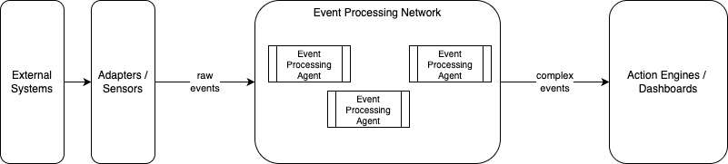

# Complex Event Processing Review

David Luckham’s 2002 book: "The Power of Events: An Introduction to Complex Event Processing in Distributed Enterprise Systems", established the foundational theory of Complex Event Processing (CEP). Based on Luckham’s the research 'Rapide' project at Stanford University, the book argues that modern enterprises are overwhelmed by distributed data and require a new paradigm to analyze and act upon real-time data in motion.

## Core Thesis and the "Event Cloud"

Traditional enterprise software relies on passive, data-at-rest architectures: systems store information in relational databases and execute retrospective queries. Luckham argues that in large-scale distributed systems, this model introduces fatal latency and blinds decision-makers to systemic anomalies.

Distributed enterprises operate inside an Event Cloud—an unstructured, partially ordered, and continuously arriving flood of millions of low-level messages (such as network packets, database commits, sensor readings, and middleware calls). The central thesis of the book is that enterprises must shift from passive databases to active, continuous event-driven processing. Systems need to extract high-level operational insight from this raw cloud in real time, before business impact is lost.

## Fundamental Concepts: Abstraction, Causality, and Patterns
Luckham defines the formal building blocks that distinguish CEP from simple message filtering or basic publish-subscribe queues:

* Events as First-Class Objects: An event is not just a message; it is a structured record of an activity. Each event contains:
    * A specific event type and parameter payload.
    * A time interval (start and end times, acknowledging that activities in distributed networks have duration rather than purely zero-length timestamps).
    * A record of causality (identifying which prior events triggered or contributed to it).
* Causality vs. Time (The Partial Ordering Problem): In distributed systems, relying solely on physical clock timestamps is unreliable due to network latency, drift, and lack of synchronization. Luckham builds on Leslie Lamport's causal models to emphasize causal ordering (the "happened-before" relation). CEP systems must determine whether Event A actually caused Event B, or whether they merely occurred concurrently.
* Event Hierarchies and Abstraction: Low-level events are rarely meaningful to business leaders or automated controllers. Luckham introduces multi-tier event hierarchies:
    * Primitive/Simple Events: Raw transactions, hardware interrupts, or network packets.
    * Composite/Intermediate Events: Groupings of related low-level events (e.g., three failed database logins from one IP address).
    * Complex Events: High-level abstractions representing business reality (e.g., "Coordinated Account Takeover Attack" or "Supply Chain Fulfillment Delay").

* Event Pattern Specification: A specialized declarative language capable of detecting relationships across streams. Patterns match based on:
    * Sequences: Event A occurs before Event B.
    * Causality: Event A caused Event B.
    * Temporal Windows: Events occurring within a sliding duration (e.g., within 5 seconds).
    * Negation: Event A occurred, but the expected confirmation Event B did not arrive within a designated window.

???+ info "Leslie Lamport's causal models to emphasize causal ordering"
    In distributed architectures, physical wall-clock timestamps cannot reliably establish whether one event led to another. Complex Event Processing (CEP) relies on causal ordering and logical clocks to transform an unordered, asynchronous stream of raw events into a coherent directed acyclic graph (DAG) of cause and effect.

    In an ideal centralized system, ordering events is trivial: compare their physical timestamps. In distributed enterprise networks, however, physical clocks fail as a source of truth for three reasons:

    * Clock Skew and Drift: Even with protocols like NTP (Network Time Protocol), physical hardware clocks across disparate servers drift by milliseconds or tens of milliseconds. In high-frequency systems, this margin of error is catastrophic.
    * Variable Network Latency: If Server A triggers an event that causes an action on Server B, the network packet notifying the CEP engine from Server B might arrive before the notification from Server A.
    * Correlation vs. Causation: Two events occurring closely in physical time may have no operational link (pure coincidence), while two events separated by hours may be directly linked by an unbroken chain of causality.
    * Relying solely on physical time creates false positives (detecting attacks or fraud that didn't happen) and false negatives (missing coordinated failures because steps arrived out of order).

    ### Lamport’s "Happened-Before" Relation
    To solve this, Leslie Lamport formalized the concept of logical time through the happened-before relation, denoted by the symbol 
    $\to$
    
    For any two events $a$ and $b$, $a \to b$ ("$a$ happened before $b$") is strictly true if and only if one of three conditions holds:
    
    * Same Process: If $a$ and $b$ occur within the same execution thread or process, and $a$ occurs prior to $b$, then $a \to b$.
    * Message Passing: If $a$ is the sending of a message by one process, and $b$ is the receipt of that same message by another process, then $a \to b$.
    * Transitivity: If $a \to b$ and $b \to c$, then $a \to c$. If neither $a \to b$ nor $b \to a$ can be proven, the two events are deemed concurrent ($a \parallel b$). In this case, neither event could have causally influenced the other, regardless of what their physical timestamps indicate.

    ### Lamport Timestamps: The Logical Clock Algorithm
    
    Lamport designed a simple mechanism to assign a monotonically increasing integer timestamp $C(e)$ to every event $e$, ensuring that causal order is respected mathematically.
    
    #### The Algorithm Rules
    Every process $P_i$ maintains an internal integer counter $C_i$, initialized to $0$:
    
    * Local Increment: Before process $P_i$ executes or emits an internal event $a$:

        $C_i = C_i + 1$
    
        $C(a) = C_i$

    * Message Transmission: When $P_i$ sends a message to $P_j$, it attaches its current counter value $C_i$ as a metadata payload $T_m$.
    * Message Receipt: When process $P_j$ receives the message with timestamp $T_m$, it updates its own clock before processing the receipt event $b$:
    
        $C_j = \max(C_j, T_m) + 1$
    
        $C(b) = C_j$
    
    #### The Clock Condition and Its Limitation
    
    Lamport clocks satisfy the Clock Condition:

    $$\text{If } a \to b, \text{ then } C(a) < C(b)$$
    
    However, the converse is not true:
    
    $$C(a) < C(b) \not\implies a \to b$$
    
    If $C(a) < C(b)$, $a$ might have caused $b$, or $a$ and $b$ might be completely independent concurrent events ($a \parallel b$) that simply occurred on processes running at different paces.
    
    Because of this limitation, advanced CEP engines often upgrade to Vector Clocks (where each process maintains an array of clocks representing the state of all other processes) or Matrix Clocks. A vector timestamp guarantees bidirectional causality:
    
    $$V(a) < V(b) \iff a \to b$$


## CEP Architecture and Processing Networks
To execute complex pattern matching, the book introduces the structural blueprint of a CEP platform:

<figure markdown="span">

</figure>

* Sensors and Adapters: Software taps embedded into existing middleware, logs, and interfaces that convert system activity into normalized event objects.
* Event Processing Agents (EPAs): Specialized software components that continuously ingest streams of events, apply filtering, aggregation, and pattern rules, and emit higher-level complex events.
* Event Processing Networks (EPNs): A directed graph of EPAs. Low-level agents feed intermediate results into higher-level agents, creating an organized pipeline of continuous abstraction.
* Continuous Query Engines: Unlike relational databases that run a query once against stationary data, CEP engines keep queries permanently compiled in memory while event data streams through them continuously.

## Real-World Applications and Legacy
Luckham outlines four primary domains where CEP delivers structural value:

* Business Activity Monitoring (BAM): Providing executive dashboards with live operational status—such as real-time tracking of logistics, inventory turns, and SLA compliance—rather than end-of-day reports.
* Financial Services & Electronic Trading: Analyzing high-frequency tick data to spot market arbitrage opportunities, calculate real-time portfolio risk, and flag algorithmic trading anomalies.
* Cybersecurity & Intrusion Detection: Correlating disparate events across firewalls, authentication servers, and file systems to detect coordinated attacks that appear harmless when viewed as isolated logs.
* Distributed System Diagnosis & Simulation: Tracing race conditions, deadlock, and performance bottlenecks across microservices and enterprise service buses using causal event graphs.

The Power of Events coined the terminology and defined the architectural requirements that later spawned modern stream processing engines (such as Apache Flink, Esper, and Kafka Streams) and enterprise event-driven architectures.

## How CEP Engines Apply Causality

In David Luckham’s model, a CEP engine is not merely a stream filter; it is an interpreter of partially ordered event sets (posets). CEP platforms operationalize causal ordering through several mechanisms:

### Causality-Aware Pattern Matching

Standard stream processing operators evaluate sequences using physical arrival windows:

```SQL
-- Standard temporal window
SELECT * FROM Stream
MATCH_RECOGNIZE (
  PATTERN (A B)
  DEFINE B AS B.temp_time > A.temp_time AND B.temp_time < A.temp_time + INTERVAL '5' SECOND
)
```

In a CEP engine applying Luckham's principles, patterns evaluate explicit causal links rather than mere time intervals:

* Causal Sequencing ($A \leadsto B$): Matches only if $A \to B$. If $B$ occurred due to an unrelated trigger, the pattern rejects the match even if $B$ arrived right after $A$.
* Causal Independence ($A \parallel B$): Used to detect concurrency anomalies, such as race conditions or double-spend attempts where two actions were taken simultaneously without knowledge of one another.

### Resolving Out-of-Order Message Jitter

When events arrive out of sequence due to network delays, the CEP engine buffers arriving events into a priority queue keyed by their logical or vector timestamps. The engine holds pattern evaluation until it receives a causal frontier (or watermark), guaranteeing that all potential causes ($a \to b$) have arrived before evaluating rules dependent on $b$.

### Causal Lineage and Event Abstraction

When an Event Processing Agent (EPA) aggregates low-level events into a high-level composite event, it inherits the causal ancestry:

* If Composite Event $E_{complex}$ is synthesized from primitive events $\{e_1, e_2, e_3\}$, the causal history of $E_{complex}$ becomes the union of the histories of $e_1, e_2,$ and $e_3$:

$$\text{Causes}(E_{complex}) = \bigcup_{i=1}^{n} \text{Causes}(e_i)$$

This enables root-cause analysis: if an alert fires at the top of the event hierarchy (e.g., "Critical SLA Breach"), the system can trace the causal edges backward through the DAG to isolate the exact microservice failure or packet drop that initiated the chain reaction.