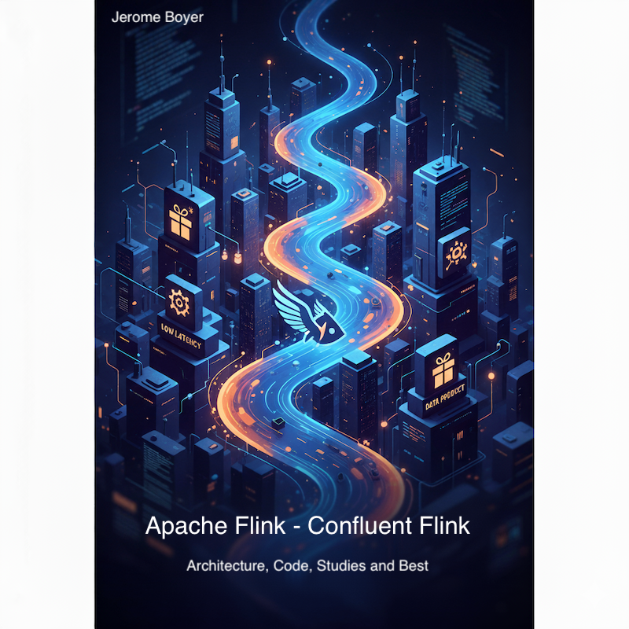

# 🚧 The Complete Guide to Apache Flink and Confluent Flink

Welcome to **"A Guide to Apache Flink and Confluent Flink"** - a comprehensive, hands-on resource for mastering stream processing with Apache Flink and its enterprise distributions. I started this living book, in 2018 while working as IBM Distinguished Enginer / CTO for [Event-Driven Architecture](https://jbcodeforce.github.io/eda-studies/), and continue to enhance it while working at AWS and Confluent. It addresses practical implementations, methodologies and best practices I can share with my customers. Since 2024, I am focusing on Confluent Flink, Data streaming processing (DSP) and [Streamhouse](./architecture/streamhouse.md). All this content come from public documentation, articles, youtube, git repositories and my current engagements with DSP projects.

To make it fun, here is the book cover! Very imaginative for a book that will never go to press.

<figure markdown="span">
  
  <figcaption>A virtual book about Apache Flink - 2018 to 2026</figcaption>
</figure>

???- info "Site updates"
    <!-- book:updates:start -->
    * Update 10/2026: new DR chapter, DR demo, agentic and real time context engine, materialized tables chapters. dbt updates.
    * update 07/2026: add new code for flink-sql, work on cookbook content 
    * update 05/2026: Snapshot query, Materialized Table, dbt, 
    * Update 02/2026: New event-driven agentic chapter, new e2e demos, SQL examples
    * Update 10/2025: k8s chapter, json xform and external lookup demos
    * Update 09/2025: Work on new demonstration, code samples, improve deployment for Confluent Platform for Flink
    * Updates 07/25: Added e2e demos, Flink estimator webapp, Data mesh
    * Updates 01/25: Added Terraform deployment examples, expanded SQL samples
    * Updates 10/2024: Reorganized content, separated SQL vs Java, added Confluent Cloud/Platform integration
    * Created 2018 

 
   
    <!-- book:updates:end -->

## What You'll Discover

This site is designed to share studies of the Flink ecosystem, covering everything from fundamental concepts to advanced real-world implementations:

### **Foundations & Architecture**
- Core Flink concepts and runtime architecture
- Stream processing fundamentals and event time semantics
- Fault tolerance, checkpointing, and exactly-once processing
- State management and stateful stream processing patterns

### **Programming with Flink**
- **Flink SQL**: From basic queries to complex analytical pipelines
- **DataStream API**: Building robust streaming applications in Java
- **Table API**: Bridging SQL and programmatic approaches
- **PyFlink**: Stream processing with Python

### **Deployment**
- Kubernetes-native deployments with Flink Operator
- Infrastructure as Code
- Monitoring, alerting, and performance optimization
- High availability and disaster recovery patterns

### **Real-World Streaming Architectures**
- **Change Data Capture (CDC)** pipelines with Debezium
- **Apache Kafka** integration and event-driven architectures
- **Data Lake** integration with Apache Iceberg
- **Real-time Analytics** with complex event processing

---

> 🚧 **This guide is still under heavy development. Content, examples, and structure may change frequently. Check back often for updates!** 🚧

---

## Enterprise-Ready with Confluent

This book provides extensive coverage of **Confluent Platform for Apache Flink** and **Confluent Cloud Flink**, including:

- **Confluent Cloud Flink** compute pools and managed services
- **Confluent Platform** on-premises deployment patterns
- **ksqlDB to Flink** migration strategies and best practices
- Integration with Confluent's Schema Registry and Connect ecosystem

## Hands-On Learning Approach

Every concept is reinforced with practical implementations:

### **Code Examples** 
- **20+ Java applications** demonstrating DataStream patterns
- **50+ SQL scripts** covering joins, aggregations, and window functions
- **Python Table API** examples and integration patterns
- Complete **end-to-end demonstrations** with multiple components

### **End-to-End Demonstrations**
- **E-commerce Analytics Pipeline**: Real-time user behavior analysis
- **CDC Deduplication**: Change data capture with transformation patterns
- **Financial Transaction Processing**: Complex event processing for fraud detection
- **IoT Data Processing**: Time-series analysis and alerting

### **Deployment-Ready Infrastructure**
- Docker Compose environments for local development
- Kubernetes manifests for production deployment
- Terraform modules for cloud infrastructure
- Monitoring stack with Prometheus and Grafana

## Who This Guide Is For

Whether you're a **data engineer** building streaming pipelines, a **software architect** designing event-driven systems, or a **platform engineer** deploying Flink clusters, this guide provides the depth and breadth you need.

**Prerequisites**: Basic familiarity with distributed systems, SQL, and Java or Python programming.

## Learning Path

This book is structured to support both **linear reading** and **focused deep-dives**:

=== "**Quick Start Track** (1-2 weeks)"
    1. [Getting Started](coding/getting-started.md) - Install Flink and run your first application (local, Docker, Kubernetes, Confluent Cloud)
    2. [Flink SQL Concepts](concepts/flink-sql.md) - Changelog modes, state in SQL operators, SQL vs. database SQL
    3. [Flink SQL Basics - DDLs](coding/flink-sql-1.md) - Stream processing with SQL: table creation
    4. [Flink SQL Basics - DMLs](coding/flink-sql-2.md) - Stream processing with SQL: queries, joins, aggregations
    5. [Local Kubernetes Deployment](coding/k8s-deploy.md) - Running Flink on Kubernetes with the operators

=== "**Foundation Track** (3-4 weeks)"
    1. [Architecture Deep Dive](concepts/index.md#runtime-architecture) - Understanding Flink internals
    2. [State Management](concepts/index.md#state-management) - Stateful stream processing
    3. [Fault Tolerance](concepts/index.md#fault-tolerance-and-consistency) - Exactly-once guarantees
    4. [Windowing, Event Time and Watermarks](concepts/index.md#windowing) - Time-based processing semantics
    5. [Materialized Tables](coding/flink-sql-3.md) - Declarative, continuously refreshed tables
    6. [Table API](coding/table-api.md) - Bridge between SQL and programmatic APIs

=== "**Advanced Track** (4-6 weeks)"
    1. [DataStream Programming](coding/datastream.md) - Complex stream processing logic
    2. [Flink SQL Advanced Topics](coding/flink-sql-adv.md) - Processing time, state bootstrapping, changelog PTFs
    3. [UDFs](coding/udf_sql.md) and [Process Table Functions](coding/ptf.md) - Extending Flink SQL with custom logic
    4. [Complex Event Processing](coding/cep.md) - Pattern detection with MATCH_RECOGNIZE
    5. [dbt for Flink SQL](coding/dbt.md) - Managing SQL pipelines as code
    6. [Kafka Integration](architecture/kafka.md) - Event-driven architectures
    7. [Confluent Cloud for Flink](techno/ccloud-flink.md) - Managed Flink, compute pools, RBAC and pricing

=== "**Production Track** (6-8 weeks)"
    1. [Production Cookbook](cookbook/index.md) - Day-2 operations overview
    2. [Deployment Models](cookbook/considerations.md) and [Cluster Management](cookbook/cluster_mgt.md) - Provisioning, scaling and sizing
    3. [Job Lifecycle](cookbook/job_lifecycle.md) - Deploying and upgrading jobs safely with savepoints and schema evolution
    4. [Application Tuning](cookbook/flink_app_tuning.md) - Memory, parallelism, checkpointing, RocksDB and bottleneck analysis
    5. [Troubleshooting and Latency Measurement](architecture/cookbook.md) - Debugging statements and measuring end-to-end latency
    6. [Monitoring & Observability](techno/fk-k8s-monitor.md) - Operating Flink on Kubernetes
    7. [Disaster Recovery](cookbook/cluster_mgt.md#3-disaster-recovery-multi-region-strategies) - Multi-region and DR strategies for OSS, Confluent Platform and Confluent Cloud
    8. [Infrastructure as Code](cookbook/terraform.md) and [Governance](cookbook/governance.md) - Terraform, change management and security
    9. [End-to-End Projects](labs/index.md) - Real-world implementations with materialized tables, dbt, advanced topics and disaster recovery

## What Makes This Guide Unique

### **Living Documentation**
- **Continuously Updated**: Content evolves with Flink releases and best practices
- **Community Driven**: Open source with contributions from practitioners
- **Practical Focus**: Every concept backed by working code examples

### **Production Tested**
- All examples are **tested and validated** in real environments
- **Performance benchmarks** and optimization guidelines
- **Troubleshooting guides** based on real-world challenges

### **Multi-Platform Coverage**
- **Apache Flink OSS** - Complete open-source implementation
- **Confluent Cloud** - Fully managed cloud service
- **Confluent Platform** - Enterprise on-premises deployment

--- 

> 💡 **Tip**: This guide is designed to be read online at [https://jbcodeforce.github.io/flink-studies/](https://jbcodeforce.github.io/flink-studies/) with full navigation, search, and interactive examples. You can also clone the [GitHub repository](https://github.com/jbcodeforce/flink-studies) to run all examples locally.
