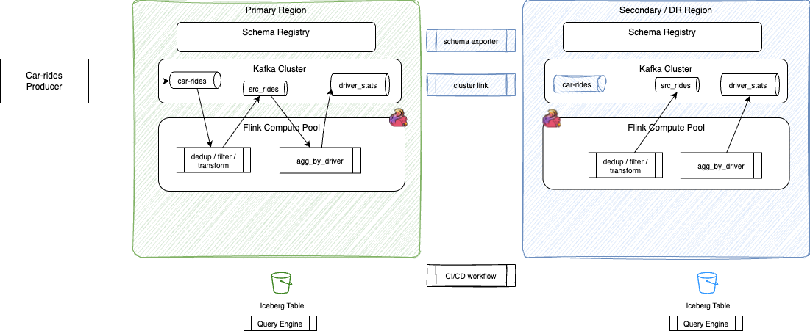
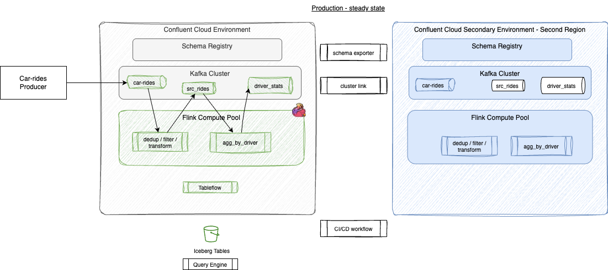
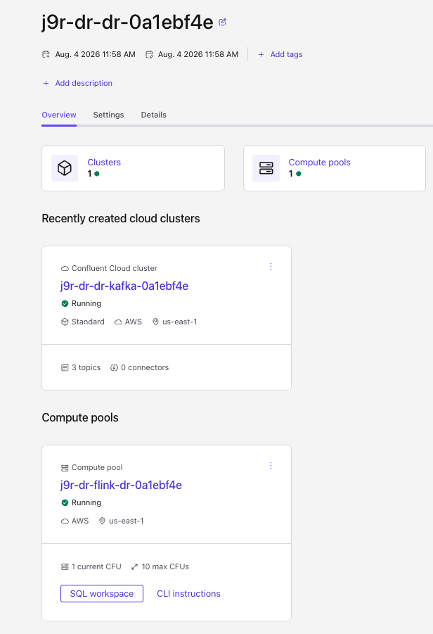

# Disaster Recovery Demonstration on Car Rides Solution

*Updated 11/17/2026*

The goal is to demonstrate a data stream processing (DSP) disaster recovery scenario for Confluent Cloud deployment. At the high level, a DSP solution includes the following elements:



1. The terraform files deploy components into two AWS regions
1. Each region has one schema registry and one to many Kafka Clusters (only one per region in this demonstration). Primary is a Standard Kafka cluster and can only be the link source. It is a reuse from deployment/cc.
1. On Confluent Cloud, we use the concept of compute pool to represent Flink resources deployed. Each region has at least one compute pool, but any production  will have more compute pools to better manage Flink statements deployment.
1. The kafka topics, can be classified in two folds: 
    a. the topics created as event sources from Kafka producers, Kafka connectors or CDC connectors. For the demonstration purpose we use a `car-rides` producer application which creates schemas and topic
    b. the topics created as part of the Flink pipelines to prepare analytics data products

    Some companies want to enforce creating topic via infrastructure as code. In Flink the semantic of the query may impact the topic properties, and a `CREATE TABLE ` does create the topic and the schema. If the data engineers clearly separate the DDL from the DML then it is possbile to deploy DDL with terraform, while DMLs can be deployed by using `dbt` or other tools

1. To get lower level of RTO and RPO, replication of data from topics to topics are setup, as well as schema exports. Not all topics are replicated as Flink statments will repopulate the data while running, in active/active mode.
1. We suppose, as most DSP solutions do, a query engine on top of Iceberg tables is used as final client of the pipelines. This engine has its own DR runbook, not addressed here. As Confluent Cloud Tableflow is enabled, dual buckets will be created the switch to DR is done to point to the DR buckets.
* To authorize cluster links and schema linking, the target cluster needs to be Enterprise. Enterprise clusters are not accessible using public endpoint.  Its bootstrap and REST hostnames only work through a PrivateLink connection. PrivateLink Attachement (PLATT) is the Confluent-side half of the private link. The AWS side is a VPC endpoint, plus a Route53 private zone. Together they resolve `*.us-east-1.aws.private.confluent.cloud` to private IPs. Schema Registry and the Flink API stay public in this setup. Anything that talks to the DR Kafka cluster has to run from inside the VPC
* So to access the DR cluster, we need a bastion host in AWS VPC, so the Kafka endpoints resolves to privatre ip addresses: 10.20.1.225 and 10.20.2.139, and ports 443 and 9092 are open. The bastion is the cheapest way to show a realistic private DR path.
* The bastion host is configured SSM-only (no public IP, IMDSv2) for the following reasons:
  * No SSH key and no inbound ports.
  * Access is controlled by IAM and logged.
 

[See this DR cookbook](https://jbcodeforce.github.io/flink-studies/cookbook/cluster_mgt/#3-disaster-recovery-multi-region-strategies) for all the details and best practices.


## Confluent Cloud Architecture & DR Strategy

From Confluent disaster recovery best practices, **active/passive** multi-region DR is the primary recommended pattern for Kafka clusters, topics, and Schema Registry. For Data Stream Processing (DSP), Flink statements can be operated either in **standby mode (deploy on failover)** or **active/active mode (parallel regional pipelines)** depending on RTO requirements and state rebuild costs.

The demonstration starts from an existing Confluent Cloud environment (grey components on the left in figure below): **j9r-env** / **j9r-kafka** (see [deployment/cc-terraform](../../deployment/cc-terraform/))



Then it provisions:

- The primary components of the DSP primary region: flink compute pool, deployed flink statements, and run producer app.
- Materialize aggregates with Tableflow to AWS Glue
- A DR Confluent Cloud environment/cluster (`us-east-1`), mirror source topic with Cluster Linking, replicate schemas with Schema Linking

See the [Step-by-Step Walkthrough](#step-by-step-walkthrough) below for the demonstration steps done with Terraform and shell scripts.

### What is covered

- Dual-region Kafka across **two environments** with bidirectional Cluster Linking
- Schema Linking: DR SR in IMPORT + exporter primary → DR (schema ID integrity)
- Flink runs as independent regional jobs (no cross-region cluster)
- Source topics replicated: rebuild from earliest + measure loss with `seq`.

| Topic | Role | Cluster Link |
|-------|------|--------------|
| `rides_raw` | Source (producer) | Yes (required) |
| `rides_clean` | Stateless Flink sink | No: dbt re-creates it on DR at failover |
| `driver_stats` | Stateful Flink sink + Tableflow | No: dbt re-creates it on DR at failover |

Only the source is replicated (topic and schemas). `rides_clean` and `driver_stats` are derived, so mirroring them would pay for topics that the DR deploy then drops and rebuilds. The cost is a longer RTO: DR Flink replays `rides_raw` from the earliest offset to rebuild them.

Event fields (JSON + Schema Registry `json-registry`): `ride_id`, `seq`, `driver_id` (key + value via `value.fields-include=all`), `rider_id`, `pickup_ts` (epoch millis), `fare_usd`, `status`, `city`. Producer uses `use.latest.version` (no auto-register).

- Soft vs promote failover runbooks (Kafka + schemas + Tableflow/Glue)

### Steady state

- **Primary** reuses existing `j9r-env` / `j9r-kafka`; **DR** is a new environment/cluster so each region has its own Schema Registry (required for Schema Linking on Confluent Cloud).
- Producer writes to primary Kafka + primary SR.
- Flink runs only on primary.
- Unidirectional Cluster Linking mirrors `rides_raw` only.
- **Schema Linking:** DR SR mode = `IMPORT`; `confluent_schema_exporter` replicates the `rides_raw-key` / `rides_raw-value` subjects from primary → DR so the source schema IDs match after failover. The schemas of `rides_clean` and `driver_stats` are registered by the DR dbt deploy.

### Failover

- Soft / promote as before for Kafka + Flink.
- Schema: pause exporter; set DR SR to `READWRITE` before producers/Flink need to register new versions; existing IDs already imported remain valid.
- Failback: reverse exporter (DR → primary with primary in `IMPORT`), then restore steady-state primary→DR exporter.


### Loss assessment

Same `seq`-based RPO / processing gap measurement as before.

## Demonstration Structure & Agent Guide

See [`AGENTS.md`](./AGENTS.md) for detailed guidelines on directory conventions, environment isolation, and agent practices.

| Folder | Content |
|--------|---------|
| [`IaC/`](./IaC/) | Terraform: primary additions, DR site, cluster link, schema linking |
| [`pipelines/`](./pipelines/) | Flink statement as dbt models |
| [`scripts/`](./scripts/) | Environment export, failover and failback scripts |
| [`python/`](./python/) | Producer and loss assessment |

## Step-by-Step Walkthrough

> Work in progress: this walkthrough is being rewritten for the layered Terraform (`IaC/00-…03-`) and the dbt-confluent Flink deployment. See [`dr-demo-execution-plan.md`](./dr-demo-execution-plan.md).

Requires CC org + AWS credentials. **Attention**, dual clusters, dual Stream Governance, and Tableflow incur cost.

### Prerequisites

- Terraform `>= 1.3`, Confluent Cloud API key with org access
- Confluent Cloud [terraform provider](https://registry.terraform.io/providers/confluentinc/confluent/latest) - version 2.86.0+
- AWS credentials (S3 + Glue + IAM for Tableflow BYOB)
- Python 3.12+ with `uv` (`confluent-kafka[schema-registry,json]`, `pydantic`)
- Optional: Confluent CLI for promote / statement stop / exporter pause

### 1. Primary additions (Layer 0)

We need to add compute pool + SA + role bindings + API key scoped to the existing primary environment so once we destroy this demonstration we are not impacting existing, commpute pools, SA, role binding and keys.
Also producer apps need a SA separated from the Flink SA so keys can be rotated independently. `rides_raw` is the only source topic created here (schemas in schemas.tf). It is an external source fed by produce_rides.py / CDC, so dbt only reads it via source(). rides_clean and driver_stats are created by the dbt deploy and
not mirrored to DR (Layer 2 mirrors `rides_raw` only).

```bash
cd IaC/00-primary-flink
# Be sure to UNSET any env variables for Flink and Kafka. Set only the following environment variables
export CONFLUENT_CLOUD_API_KEY=...
export CONFLUENT_CLOUD_API_SECRET=...
terraform init && terraform plan && terraform apply
```

### 2. Produce records to `rides_raw`

* To validate primary flink execution we can run few records:
  ```bash
  cd scripts
  source export-env.sh primary
  cd ../python
  uv sync
  uv run produce_rides.py --interval 0.5 --topic rides_raw --max-events 200
  ```

The producer does **not** auto-register schemas; it uses `use.latest.version` against `rides_raw-key` / `rides_raw-value` created terraform.

* Verify records in topic:
  ```sh
  ./scripts/peek-topic.sh primary rides_raw --last 5
  ```

### 3. Deploy primary Flink statements

`pipelines/profiles.yml` is a project-local profile with no secrets. Every value comes from the environment set by `scripts/export-env.sh` . The primary target uses cloud and region. The dr target uses endpoint.

* Start virtual environment with dbt-confluent
  ```sh
  cd ../../code/dbt
  uv sync
  source .venv/bin/activate
  ```

* Load environment variables in current shell
  ```sh
  cd e2edemo/dr-car-rides
  source ./scripts/export-env.sh 
  ```

* Deploy flink statements with dbt
  ```bash
  cd pipelines
  dbt run --profiles-dir . --target primary 
  # redeploy
  dbt run --profiles-dir . --target primary  --full-refresh
  ```

Statements created on the primary cluster:
```sh
dr-dims-rides-clean
dr-facts-driver-stats
```

### 4. DR environment, cluster link and schema link

#### DR Site
* IaC/01-dr-site has the terraform for DR environment, Enterprise kafka cluster, Schema Registry, Flink pool. Cluster linking and Schema Linking enforce having an enterprise kakfa cluster which can only be accessed via private link. So the terraform is also adding a EC2 managed by AWS SSM, as bastion host.



```sh
aws sso login --profile 8...
cd IaC/01-dr-site
terraform plan
terraform apply
```

* Terraform output:
  ```sh
  dr_bastion_instance_id = "i-0965dddd3d7cc25d0"
  dr_bastion_ssm_command = "aws ssm start-session --target i-0965dddd3d7cc25d0 --region us-east-1"
  dr_bootstrap_endpoint = "lkc-zmw98jz.us-east-1.aws.private.confluent.cloud:9092"

  dr_schema_registry_id = "lsrc-386mo5m"
  dr_schema_registry_resource_name = "crn://confluent.cloud/organization=49cee212-6346-438a-a1fa-d1b1cbd90d44/environment=env-k2595g/schema-registry=lsrc-386mo5m"
  ```

* The bastion is accessible via command like: `aws ssm start-session --target i-0965dddd3d7cc25d0 --region us-east-1`

#### Schema Linking

* IaC/03-schema-linking: prepare the schema linking for the subjects of the demonstration. Same terrform commands, from the laptop (the DR Schema Registry endpoint is public).
*  Schema Registry rejects an exporter with a wildcard plus other entries, which is we need exact subject names. Only `rides_raw-key` and `rides_raw-value` are exported. If a new source topic is added, add its two subjects to exported_subjects.


#### Cluster Link

* `02-cluster-link`: the DR (Enterprise, private) cluster pulls from the primary. The link lives on DR, so nothing has to reach into the primary network. Only `rides_raw` is mirrored.
* **This layer runs on the bastion, not on the laptop.** The link and the mirror are created through the DR Kafka REST endpoint, which only resolves inside the DR VPC. `terraform apply` on the laptop fails with `lookup lkc-....us-east-1.aws.private.confluent.cloud: no such host`. Use the wrapper, which copies the code to the bastion through SSM and runs Terraform there:

  ```sh
  export AWS_PROFILE=<your-sso-profile>
  scripts/push-outputs.sh                    # once after each layer apply: iac-outputs.json -> Parameter Store
  scripts/bastion-sync.sh -- scripts/bastion-setup.sh   # once: terraform, uv, git on the bastion
  scripts/apply-cluster-link.sh --plan       # then run it without --plan
  ```

  The state of this layer lives on the bastion (`/opt/dr-car-rides/IaC/02-cluster-link`), and later syncs do not overwrite it. `scripts/apply-cluster-link.sh --destroy` removes the link and the mirror. `scripts/tfvars-from-outputs.sh 02-cluster-link` refuses to run where the DR endpoint does not resolve, so a local `terraform apply` cannot be prepared by mistake. A `terraform.tfstate` left in `IaC/02-cluster-link` on the laptop by a failed run is empty and can be deleted.


#### Inspect topic content (primary and DR)

The Confluent Cloud message viewer does not work on the private DR cluster ("your browser must have access to your cluster's private endpoints"). [`scripts/peek-topic.sh`](./scripts/peek-topic.sh) reads the messages instead: primary directly from the laptop, DR from the bastion. It is read-only (a throwaway consumer `group.id`, no committed offsets), so it is safe on mirror topics.

```bash
export AWS_PROFILE=<your-sso-profile>            # DR only: used to reach the bastion
scripts/peek-topic.sh dr rides_raw --stats       # offsets per partition: is the mirror caught up?
scripts/peek-topic.sh dr rides_clean --last 10
scripts/peek-topic.sh dr driver_stats --partition 3 --last 5
scripts/peek-topic.sh primary rides_raw --follow # live tail, primary only
```

Each line is JSON with `partition`, `offset`, `timestamp`, the decoded `key` and `value`, and the Schema Registry `schema_ids`. Comparing `schema_ids` and `seq` between primary and DR shows that the mirrors and the schema link preserved both. After a failover, the same command shows what the promoted DR topics hold.

### 5. Primary Region Failure

To simulate a primary region failure, we first run the `python/produce_rides.py`, then inject the outage, then fail over. 

The outage is an authorization failure (Confluent Cloud cannot switch a cluster off), not a network partition. The producer SA is also the cluster link's source credential, so the link stops mirroring, as in a real outage. The seq log only holds records the primary acknowledged, so `assess_loss.py` compares the acknowledged high-water with the max seq DR holds: the difference is the RPO in records. `failover-hard.sh` runs the assessment and prints the DR producer command with `--start-seq`.


We need 2 shell terminals:

* Terminal 1: 
  ```sh
  cd python && source ../scripts/export-env.sh primary 
  uv run produce_rides.py --interval 0.5
  ```
* Terminal 2:  export only CONFLUENT_CLOUD_API_KEY and CONFLUENT_CLOUD_API_SECRET. Do not export the KAFKA_, FLINK_ or SCHEMA_REGISTRY_ variables, because the Terraform provider fails when they are set. Then run:
  ```sh
  ./scripts/simulate-primary-outage.sh.
  ```

  Wait about a minute. The producer should print DELIVERY FAILED and the DR mirrors should stop advancing. 
  
* You can check with:
  ```sh
  scripts/peek-topic.sh dr rides_raw --stats.
  ```

* Fail over by stoping flink on primary, run dbt on dr
  ```sh
  AWS_PROFILE=<profile> scripts/failover-hard.sh
  ```

  Some output:

  ```sh
  1/5 Primary: stop Flink statements, pause the schema exporter (best effort)
    dr-dims-rides-clean: stop requested, phase now STOPPED
    dr-facts-driver-stats: stop requested, phase now STOPPED
    exporter state: PAUSED
  2/5 DR Schema Registry: check the subjects, set READWRITE
    rides_raw-key id/version=101088/3
    rides_raw-value id/version=101089/3
    DR registry mode: READWRITE
  3/5 Fail over the mirror topics (on the bastion, mode=failover)
      === Mirror failover: rides_raw

  4/5 dbt deploy on DR
  5/5 Measure the loss
  status: Success
  max seq held by DR rides_raw: 210
  {
    "producer_high_water_seq": 210,
    "pre_failover_max_seq": 210,
    "post_mirror_max_seq": 210,
    "replication_rpo_estimate": 0,
    "processing_gap_estimate": 0,
    "notes": [
      "Producer high-water seq=210",
      "replication_rpo_estimate = pre_failover_max_seq - post_mirror_max_seq (messages not yet mirrored at cutover)",
      "processing_gap_estimate vs producer includes unreplicated tail + unprocessed"
    ]
  }

  ```

  The Kafka cut-over runs from the bastion.

* Start the producer on DR site:
  ```sh
  scripts/bastion-sync.sh -- "cd python && source ../scripts/export-env.sh dr && uv run python produce_rides.py --interval 0.5 --start-seq 211"
  ```

* **The demo ends here:** DR serves the traffic and `failover-hard.sh` printed the RTO and the RPO. Nothing more is required.

* Optional, only to leave the environment in its original state (see "Resetting after a hard failover" in section 7):

```sh
scripts/simulate-primary-outage.sh --restore   # give the primary SAs their roles back
scripts/failback.sh                            # resume the primary Flink statements and the exporter
```


### 6. Measure RPO and sequence loss

The script: `scripts/failover-hard.sh` runs already the assess loss metrics. In case of it can be rerun using:

```bash
cd python
uv run assess_loss.py --producer-log /tmp/dr-car-rides-seq.log \
  --pre-failover-max-seq <N> --post-mirror-max-seq <M>
# or sample a topic directly (Kafka env from export-env.sh):
uv run assess_loss.py --producer-log /tmp/dr-car-rides-seq.log --sample-topic rides_raw
```

--- 
### 5. Graceful (soft) failover

In a separate terminal:

```bash
cd scripts
./failover-soft.sh
```

This will:
1. Stop primary Flink DML statements (`dr-dims-rides-clean`, `dr-facts-driver-stats`).
2. Instruct the Schema Registry mode transition (switch DR SR from `IMPORT` to `READWRITE`).
3. Deploy Flink statements on the DR compute pool (`make deploy SITE=dr`).

Retarget the producer to the DR site:

```bash
source ./export-env.sh dr
cd ../python
uv run produce_rides.py --interval 0.5
```


Before failback, restore the primary access: `scripts/simulate-primary-outage.sh --restore` (targeted `terraform apply` of the two role bindings).

To rerun the scenario from a clean DR, run `AWS_PROFILE=<profile> scripts/cleanup-dr.sh --reset-seq-log`. It stops `produce_rides.py` on the laptop and on the bastion, deletes the DR dbt statements, the `rides_clean` / `driver_stats` topics and their subjects. Then re-apply Layer 3 so the exporter drops the stale subjects.

`scripts/failover-promote.sh --mode failover` is the step `failover-hard.sh` runs on the bastion; do not run it from the laptop.

### 8. Failback to primary

```bash
cd scripts
./failback.sh
```


### 9. Tear down the demonstration

The layers share credentials, so destroy them in the reverse order of creation. Layers 2 and 3 are built from the API keys and endpoints that layers 0 and 1 own (`scripts/tfvars-from-outputs.sh`), so layers 0 and 1 must outlive them. Everything here is scoped to the demo (own service accounts, compute pools, API keys, the `rides_raw` topic and its subjects), so the shared primary environment, Kafka cluster and Schema Registry stay in place.

| Order | What | Where | Why this order |
|-------|------|-------|----------------|
| 0 | Producers, Flink statements, dbt topics | laptop + bastion | Created outside Terraform. A running statement re-creates its topic and holds the compute pool |
| 1 | Layer 3, schema link | laptop | Needs the Layer 0 primary SR key and the Layer 1 DR SR key |
| 2 | Layer 2, cluster link and mirror | **bastion** | Needs the Layer 0 producer key (link credential) and the private DR Kafka REST endpoint. Its state lives on the bastion, so it must go before the bastion |
| 3 | Parameter Store entry | laptop | Last read by layer 2. Created by `push-outputs.sh`, not by Terraform |
| 4 | Layer 1, DR site: bastion, PrivateLink, VPC, DR environment, cluster, SR, Flink pool | laptop | Nothing depends on it anymore |
| 5 | Layer 0, primary additions: Flink pool, service accounts, API keys, `rides_raw` and its schemas | laptop | Last: it owns the keys used by the layers above |

Keep `scripts/iac-outputs.json` until step 2 is done: layers 2 and 3 read their variables from it. If any layer was re-applied since it was generated, run `scripts/generate-outputs.sh` and `scripts/push-outputs.sh` first.

**Credentials:** export `CONFLUENT_CLOUD_API_KEY` / `CONFLUENT_CLOUD_API_SECRET` only. Do not export `KAFKA_`, `FLINK_` or `SCHEMA_REGISTRY_` variables in that shell, because the Terraform provider fails when they are set. The bastion steps and Layer 1 also need `aws sso login --profile <profile>`.
 Be sure to verify if `~.aws/credentials` does not have older token. Terraform's AWS provider reads that file first for the profile. It finds the old session token and never reaches the SSO settings in `~/.aws/config`, so STS rejects it as ExpiredToken. Run `aws sts get-caller-identity`

```bash
export AWS_PROFILE=<your-sso-profile>

# 0. Stop what Terraform does not own
scripts/simulate-primary-outage.sh --restore    # only if the outage was injected and not restored yet
scripts/cleanup-dr.sh --yes                     # producers (laptop + bastion), DR statements, DR rides_clean / driver_stats + subjects
export FLINK_DATABASE=j9r-kafka
(cd pipelines && make teardown SITE=primary)    # primary dbt statements, then drop rides_clean / driver_stats

# 1. Layer 3: schema exporter and DR IMPORT mode. Laptop.
scripts/tfvars-from-outputs.sh 03-schema-linking
(cd IaC/03-schema-linking && terraform init && terraform destroy)

# 2. Layer 2: cluster link and the rides_raw mirror. Runs on the bastion.
scripts/apply-cluster-link.sh --destroy

# 3. Parameter Store entry that holds iac-outputs.json
scripts/push-outputs.sh --delete

# 4. Layer 1: DR site
(cd IaC/01-dr-site && terraform destroy)

# 5. Layer 0: primary additions
(cd IaC/00-primary-flink && terraform destroy)
```

Notes:

* **Why step 0 is not Terraform.** The DR statements and the DR `rides_clean` / `driver_stats` topics and subjects were created by dbt, and a failover turns the `rides_raw` mirror into a regular topic. Terraform does not know about the first group, and a running statement would re-create them.
* **`rides_raw` on DR after a failover.** If the layer 2 destroy fails on the stopped mirror topic, delete it with `scripts/cleanup-dr.sh --yes --include-raw` and run `scripts/apply-cluster-link.sh --destroy` again. If the topic is already gone, Terraform just drops it from the state. As a last resort, remove it from the state on the bastion: `scripts/bastion-sync.sh -- "cd IaC/02-cluster-link && terraform state rm 'confluent_kafka_mirror_topic.dr[\"rides_raw\"]'"`.
* **If the layer 3 destroy fails on the exporter**, pause it and retry. `failover-hard.sh` has already paused it after a hard failover:

  ```bash
  ( source scripts/export-env.sh primary >/dev/null
    curl -sS --max-time 30 -X PUT -K <(printf 'user = "%s:%s"\n' "$SCHEMA_REGISTRY_API_KEY" "$SCHEMA_REGISTRY_API_SECRET") \
      "$SCHEMA_REGISTRY_ENDPOINT/exporters/$SCHEMA_EXPORTER_NAME/pause" )
  ```

* **Do not skip layers 2 and 3** even though layer 1 deletes the DR environment. The exporter is registered in the shared primary Schema Registry, and the link consumes from the primary cluster. Without these destroys, the primary registry keeps an exporter that points at a registry that no longer exists.
* **Local leftovers.** After the destroys you can delete `IaC/*/terraform.tfstate*`, `IaC/*/terraform.tfvars.json` and `scripts/iac-outputs.json`. They are gitignored and contain secrets.
